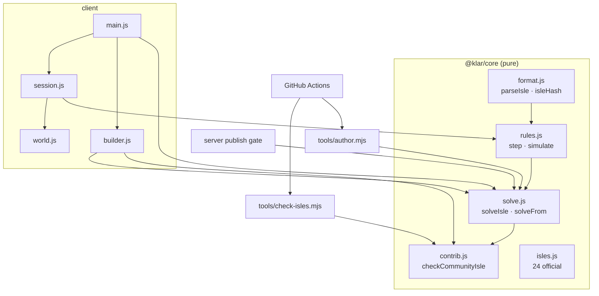

# Klarbase — Engineering Source of Truth (v2: Isles)

> **Tiny floating isles · clever little paths.**
>
> The single engineering source of truth for klarbase.dev — for the CTO, every developer,
> and every AI agent. **v2 (2026-10-18)** replaced the camera-illusion "maquette" game with
> cozy, turn-based **Isles**. The v1 document (voxel engine, illusion maths, the first deploy
> day, sessions a–k) is preserved in [`docs/archive/v1/ENGINEERING-v1.md`](docs/archive/v1/ENGINEERING-v1.md).
>
> **Last updated:** 2026-10-19 · **Owner:** CTO · **Repo:** `TanmoyP/klarbase` (public, MIT)

## 0. How to use this document
- It is **living**. Every session that changes rules, data, infra or the roadmap updates the
  relevant section **and** appends to the Session Log (§13). A stale source of truth is worse than none.
- **Roadmap sections are placeholders** for the CEO / CMO / CTO to turn into commitments.
- The rules of the game are written once in code (`core/src/isle/rules.js`) and once in prose
  (`isles/README.md`). If they ever disagree, the code wins and the prose is a bug.

---

## 1. The game

Klarbase is a cozy puzzle game of **isles**: tiny floating dioramas — terraced cliffs, roots,
waterfalls spilling off the rim, glinting crystals — over a sea of cloud. You guide **Pip**, a
round sprout spirit, one hop per key, to the glowing star. Two loops, one engine:

- **Play** someone else's isle — 24 official isles in five themed chapters, community isles
  merged on GitHub, and isles shared online.
- **Create** your own — paint tiles on a grid, watch the isle grow in 3D, and the solver tells
  you instantly whether it's solvable and its par. Share it online or contribute it by PR.

**Design pillars (non-negotiable):**
1. **Readable.** Discrete, turn-based, one key = one move. ↑ always means "away from you". No
   physics, no timing, no luck — the board tells the whole truth.
2. **Verifiable.** Every isle is checked by a solver: solvable, with an exact par and a
   replayable shortest solution. Nothing unsolvable ships — official, community or online.
3. **Small vocabulary, deep combinations.** ~20 tile types, 7 rules. New mechanics are a schema
   decision, never slipped in (see §11).
4. **Cozy, not punishing.** Undo is free, stars judge your final path, hints are honest
   ("you're stuck — undo"), and the world looks alive even when you're thinking.
5. **Open.** Anyone can build; anyone can contribute by PR; credit is enforced by CI.

**Vocabulary:** *isle* (one puzzle) · *Pip* (the critter) · *par* (shortest solution length) ·
*smart solution* (a shortest key combo, e.g. `RRUULLLUU`) · *chapter* (a theme's set of official
isles) · *official / community / online isle* (where it comes from). Internal code still calls
a stored isle a `Puzzle` (table, `/api/puzzles`) — don't rename in passing.

---

## 2. Architecture (CodeGraph)

```
klarbase/
├── core/                 @klar/core — pure, zero-dep, isomorphic. THE rules.
│   ├── src/isle/         format.js · rules.js · solve.js · contrib.js · isles.js (24 + 5 Twist + 8 Hanging Gardens)
│   │                     difficulty.js (audit + K3 score + tiers) · daily.js (Daily Isle pick/number/share)
│   ├── src/*.js          legacy voxel engine — kept only for the deferred world API
│   └── test/             isles.mjs · difficulty.mjs · run.mjs (legacy, 57)
├── client/               @klar/client — Vite + three.js
│   ├── index.html        shell + all CSS (glass UI, responsive)
│   └── src/
│       ├── main.js       screens, routing, catalogue, HUD, solution gating, input
│       ├── builder.js    the isle builder (2D paint + live 3D + live solver + export)
│       └── game/         world.js (scene) · props.js (procedural art) · pip.js (critter)
│                         session.js (play/undo/hint/replay) · audio.js (synth) · themes.js
├── server/               @klar/server — Express + Prisma + better-auth
│   └── src/routes/       puzzles.js (isle publish gate, public play/browse) · plays.js (anonymous
│                         per-isle stats, K7) · stats.js (maintainer counts) · world.js (deferred)
├── isles/
│   ├── community/<user>/<id>.json   community isles — bundled into the client with credit
│   ├── daily/<YYYY-MM-DD>.json      hand-made Daily Isles (same gate, daily rules)
│   ├── README.md         the format + rules for players, contributors and builder bots
│   └── MAINTAINERS       who may edit any community folder
├── content/isles/        generated artifacts for the official isles (deterministic)
├── tools/
│   ├── check-isles.mjs   the PR gate for community + daily isles (zero-dep, data-only)
│   ├── author.mjs        verifies official isles, writes content/isles, --seed to DB
│   └── difficulty.mjs    prints the solver audit + gut/audit tier of every official isle
└── .github/              ci.yml · CODEOWNERS · PR template · ruleset-main.json
```



**The one architectural rule:** the rules exist only in `@klar/core`. The game, the builder,
the solver, the PR checks, the artifact tool and the server's publish gate all import the same
module — so a player, a reviewer and the server can never disagree about an isle.

**Data flows.**
- *A move:* key → `world.arrowToMove()` (camera-relative) → `step(level, state, move)` →
  `{state, events}` → `world.play()` animates the events in order → HUD updates.
- *A PR isle:* builder **Export for GitHub** (runs `checkCommunityIsle`) → contributor commits
  `isles/community/<me>/<id>.json` → CI `isles` job → required check → merge → next build bundles
  it via `import.meta.glob` → Community tab, credited.
- *An online share:* builder **Share online** (signed in) → `POST /api/puzzles` → server parses +
  solves (budget 200k) → stores canonical isle + par + solution under its content hash → `/i/<hash>`.

---

## 3. The isle format

Full spec: [`isles/README.md`](isles/README.md). In short: `rows` of space-separated tokens,
row 0 = north. Token = tile char + optional height digit 0–5.

`. , S G # T ~ * ^ v < > C o D L = _ k K p q -` — ground, flowers, start, goal, rock, tree,
water, ice, four stairs, crate, plate, gate, lever, bridge-up, bridge-down, key, door, arch pair
A, arch pair B, empty sky.

**Limits:** ≤ 14×14, heights 0–5, ≤ 8 crates, exactly one start, ≥ 1 goal, arches in pairs, a
gate needs a plate. **Identity:** `isleHash` = SHA-256 of `{schemaVersion, theme, rows}` with
whitespace normalized — name, author, par, hints never change it. Same isle ⇒ same hash in
browser, Node and DB.

**Archipelago maps (schemaVersion 6, K4, Phase 2):** `{schemaVersion:6, theme, storeys:[{rows, at:[x, z, altitude]}]}` —
1–3 storeys, each ≤ 14×14, `x`/`z` 0–40 map tiles, `altitude` 0–24 height levels; storeys that
share map tiles must float ≥ 8 levels apart (`E_OVERLAP`). New tokens, **map-only** (`E_V6` in a v5
file): `a` / `b` Sky Scales pans (height digit = base, 1–4, `E_PAN_H`; both or neither, `E_PANS`),
`r` a third arch pair. A pan is its own token, so it can't also be water/ice/plate/crate/start/
goal/key (`E_PAN_PLAIN` names the mistake). `parseIsle` flattens storeys side by side (one void
column between) into ONE cell list: `level.storeys = [{w, h, at, x0}]`, `level.sid[i]` = storey of
cell i, `cellPlace(level, i)` → storey/local/map coordinates. `neighbor()` returns -1 across a
storey edge, so no rule ever crosses one; an arch pair whose arches sit on different storeys is a
**gateway** (`cell.gateway`, `tp` event with `gateway:true`, mechanic `gateway`).
**Identity:** a v5 doc (`rows`) hashes exactly as before — `canonicalIsle`'s v5 branch is frozen;
`core/test/isles.mjs` pins all 24 pre-map official hashes + `isles/community/**` and re-derives the
v5 formula independently. A map hashes `{schemaVersion:6, theme, storeys:[{rows, at}]}`.
The builder writes v5 unless the isle needs a map (2+ storeys, an offset, pans or arch C).

**Weight II tiles (Phase 3, K1/K6/K9) — map-only too:** `B` balloon post, `P` stone pile, `u`
buoy (a piece like a crate; crates + buoys ≤ 8, `E_CRATES`), `n e s w` gust vents (blow N/E/S/W),
`+` seed (≤ 3, `E_SEEDS`). The parser precomputes **gust lines** (`level.gusts = [{dir, cells}]`,
`level.inGust` cell → line): from the vent along its direction over non-void floor no higher than
the vent (pans by base), stopped by rock, tree, gate, door, ramp, the sky or the storey edge; two
lines may not share a tile (`E_GUSTS`). Also `level.buoys / posts / piles / seeds`. Hashing is
unchanged (same v6 canonical form).

**`tier` (2026-10-19, K3):** optional gut call — `breeze · easy · tricky · hard · fiendish · mythic`
— on official isles (all 29 declare one), community files, daily files (required there) and online
shares (publish payload). Presentation only: never part of the hash (`core/test/difficulty.mjs`
pins all 24 pre-existing hashes).

### Difficulty score (K3) — `core/src/isle/difficulty.js`
- `auditIsle(level, {maxStates=200000})` → `{states, deadPct, traps, away, greedy, routes, par, capped}`
  (moved here from `tools/difficulty.mjs`, identical numbers; lean nodes = key, Pip tile, out-edges).
- `TIERS`: Breeze 0–15 · Easy 15–35 · Tricky 35–55 · Hard 55–72 · Fiendish 72–88 · Mythic 88–100.
- `provisionalPrior(audit)`: the proposal §4.2 table — highest tier whose bar is cleared
  (Easy ≥ 50 states; Tricky ≥ 300 & ≥ 2 traps & ≤ 6 routes; Hard ≥ 3k & ≥ 3 traps & ≤ 4 routes;
  Fiendish ≥ 30k & ≥ 4 traps & ≤ 2 routes; Mythic > 150k, or ≥ 6 traps **and ≥ 30k states**, with
  1 route — the 30k floor is ours: `traps` counts any step with one losing move, so crate isles
  reach 6 traps at a few thousand states and would all read Mythic; greedy win
  ⇒ Breeze; capped ⇒ Fiendish), placed inside the band by log(states).
- `observedScore(stats)` (0–100): weights .35 not-cleared rate · .20 median time to clear (log
  15 s → 30 min) · .20 median moves over par (par → 3× par) · .15 hints/attempt (0 → 3) ·
  .10 restarts/attempt (0 → 3). Each term is monotonic; with no clears, time and moves count as 1.
- `difficultyScore({tier, audit, stats})` = `(20·prior + n·observed)/(20 + n)`, prior = declared
  tier midpoint, else provisional prior, else Easy; `settling` while n < 20.
- Builder helpers: `harderHints(audit)` (K2 "make it harder", optional) and `gutMismatch(tier, audit)`
  (warn, never block, when gut and audit differ by ≥ 2 tiers).

## 4. The rules & engine

The seven rules (also in `rules.js` header and `isles/README.md`):
1. Move one tile N/S/E/W onto floor at the **same height**, **hop down** one level, or **climb
   via stairs** (only along their slope). Never climb a ledge.
2. Walk into a **crate** to push it (same height, or off a one-level ledge). Into **water** it
   sinks and becomes floor.
3. **Ice** slides you (and crates) until something stops you.
4. **Gates** are open while every **plate** is pressed (read at the start of the move).
5. A **lever** (Use / `X`) flips every bridge; a crate on a sinking bridge drops in as a block.
6. **Keys** open **doors** one each; an **arch** sends you to its twin (across storeys: a gateway).
7. Reach a **goal**.

**Sky Scales (K1, Phase 2):** pans `a` and `b` hang from one vine. `WEIGHT = {pip:1, crate:1}`;
`panTilt(level, s)` = sign(load A − load B); `heightAt(level, i, tilt)` = base − tilt on A, base +
tilt on B, everything else unchanged. A move is judged entirely with the tilt at its **start**
(walking, pushes, crate drops, ice slides — like gates reading plates); after it settles the tilt is
recomputed (`scales{from,tilt}` event) and whatever stands on a pan rides with it. No cascades.
Pans may sit on different storeys. Heights are derived from positions, so **the solver state does
not grow** (test asserts the same state shape and `stateKey` fields).

**Weight II (K1, K6, K9, Phase 3):** Pip holds one thing (`state.hold` = `''|'balloon'|'stone'`).
Use (`X`) priority: lever → toggle; post with its balloon still there + empty hands → take
(`state.posts` lists emptied posts); pile + empty hands → stone; pile + stone → put back; holding a
balloon anywhere else → release (gone). `WEIGHT = {pip:1, crate:1, buoy:-1, balloon:0, stone:2}`,
`pipWeight(s)`; plates count Pip only if `pipWeight > 0`; `panTilt` sums Pip, crates and buoys.
**Glide** (`glideTo`): a balloon-Pip move that can't be walked descends one level per tile from the
exit height and lands on walkable floor whose height equals the altitude; 1-tall things (rock, tree,
ramp, closed gate/door, crate, grounded buoy) block unless cleared from above; water or floor at or
above the altitude, an edge, or altitude < 0 → blocked (`glide{from,to}`). **Buoys** (`state.buoys`):
pushed like crates (`buoyCanEnter`: same height or **up** one, never down; onto open water or a sunk
bridge they float, `float{at}`); a floating buoy is floor for Pip (never pushed) and doesn't fill.
**Gusts:** `windAt(level, s, i)` walks the cell's line from the vent — a crate on an earlier tile
(the vent included) shelters it. After a move settles and Pip hasn't just reached a goal, `blow()`
moves every light thing in the wind one tile downwind if it can — balloon-Pip by walk rules (no
push, no glide; `enter()` effects apply), buoys not under Pip by `buoyCanEnter` — farthest-downwind
first (`gust{from,to,buoy?}`). **Brace rule:** pushing a piece whose tile is in a wind blowing
against the push needs `pipWeight > GUST (1)`. Balloon-Pip never pushes. **Seeds** are *not* state:
`seedsTouched(level, r)` (cells Pip stood on during a step) and `solveSeeds(level)` (BFS over state
+ seed bitmask) give the seed par; official isles store `seedPar`, verified by tests + `author.mjs`.

**State:** `{p, crates[], filled[], keys, got[], opened[], flip, hold, buoys[], posts[]}` — everything that can change.
`step(level, state, move)` is pure and total: it returns `{ok:false}` for a blocked move or
`{ok, state, events, won}` where `events` (`walk/slide/tp/push/cslide/sink/fall/key/door/toggle/gate/win`)
(+ `scales`, and `tp` may carry `gateway:true`) drive animation in order. **Solver:** BFS over `stateKey(state)` from any state (`solveFrom`) —
the first win found is a shortest solution, so `par` is exact. Budgets: 300k states (core
default), 200k (PR checks + server), 150k (in-game hints). **Stars:** ≤ par → 3, ≤ ⌈1.5·par⌉ → 2, else 1.

**Undo** restores the previous state and the move count (stars judge your final path, not
your experiments). **Hints** show the best next move *from where you stand* (`solveFrom`), or
say honestly that this position can no longer reach the goal.

### Solution gating (earned, not handed out)
A solution — and hints beyond the first — unlock for an isle when **any** of:
signed in (contributors sign in with GitHub) · the isle is cleared · real effort on it:
≥ 3:00 of **active** play (only time between moves counts; idle gaps > 20 s are ignored)
**and** ≥ max(30, 3 × par) moves. The builder shows par but hides the route unless signed in;
the server only sends stored solutions to signed-in players. **This is a soft gate by design:**
the engine ships a solver and the repo is open, so a determined player can always extract a
route. The goal is protecting the "aha" for players who try, not secrecy.

---

## 5. Content

**24 official isles, five chapters**, all verified in CI (`core/test/isles.mjs` + `tools/author.mjs`):

| # | Isle | Chapter | Par | Mechanics the solution uses |
|---|---|---|---|---|
| 1 | First Steps | Canopy | 4 | stairs |
| 2 | Ledge Drop | Canopy | 11 | stairs, hop-down |
| 3 | Mossy Crate | Canopy | 9 | push, sink |
| 4 | Root Bridge | Canopy | 12 | stairs, hop-down, push, sink |
| 5 | Fern Gate | Canopy | 15 | push, gate |
| 6 | Mirage | Mirage | 3 | arches |
| 7 | Twin Mirages | Mirage | 7 | arches |
| 8 | Sunken Well | Mirage | 8 | push, sink, arches |
| 9 | Palm Plates | Mirage | 22 | push, gate |
| 10 | Tide Lever | Lagoon | 7 | lever |
| 11 | Low Tide | Lagoon | 14 | lever |
| 12 | Coconut Key | Lagoon | 17 | push, sink, key, door |
| 13 | Lagoon Locks | Lagoon | 16 | key, door (a trap door) |
| 14 | Rooftops | Rooftops | 14 | stairs, push |
| 15 | Canal Lift | Rooftops | 8 | push, lever, crate-drop |
| 16 | Subway | Rooftops | 13 | arches, key, door |
| 17 | Night Market | Rooftops | 17 | push, arches, gate |
| 18 | Crosswalk | Rooftops | 24 | push, gate |
| 19 | First Frost | Summit | 4 | ice |
| 20 | Glacier Stops | Summit | 9 | ice |
| 21 | Snowball | Summit | 11 | push, ice |
| 22 | Glacier Maze | Summit | 13 | ice |
| 23 | Frozen Gate | Summit | 19 | push, ice, crate-slide, gate |
| 24 | The Peak | Summit | 27 | stairs, push, arches, key, door |

**Gut tiers** (2026-10-19): Breeze — First Steps, Ledge Drop, Mossy Crate, Mirage, Twin Mirages,
Tide Lever, First Frost · Tricky — Palm Plates, Crosswalk, Frozen Gate, The Peak · Easy — the rest.

**Twist isles (Phase 1, 2026-10-19)** — one optional side-path isle per chapter, appended to its
chapter, `twist:true`, existing tiles only, each built around a written catch (comment above it
in `isles.js`). Main-path numbering, Continue and "Next isle" skip them. Targets enforced in
`core/test/difficulty.mjs`: ≥ 3,000 states, ≥ 3 traps, greedy fails, ≤ 4 shortest routes, ≤ 60 tiles.

| Twist | Chapter | Gut | Par | States | Traps | Greedy | Routes | Tiles | Audit | Catch (short) |
|---|---|---|---|---|---|---|---|---|---|---|
| Spring Lock | Canopy | Fiendish | 33 | 33,679 | 9 | fails | 1 | 41 | Mythic | the crate on the south plate must drown in the spring so you can load the east plate |
| Revolving Arch | Mirage | Hard | 30 | 5,865 | 8 | fails | 1 | 30 | Hard | arches are a revolving door; both plates need crates, pushed from the side that misses the spring |
| Sunken Step | Lagoon | Hard | 35 | 8,776 | 7 | fails | 1 | 35 | Hard | the lever sinks your way back; park the walled-in crate on that bridge after paving the springs |
| Street Drop | Rooftops | Hard | 23 | 7,332 | 9 | fails | 1 | 26 | Hard | crates only go down; the crate that lands on the near plate is the only one that reaches the far one |
| Frost Ferry | Summit | Hard | 20 | 8,014 | 7 | fails | 1 | 36 | Hard | one push glides a crate onto the plate, but only from one tile two rows from where it starts |

Designed with a scratch solver harness: write the catch and a draft around it, then hill-climb the
filler tiles (crate, plate, gate and key cells pinned) until the solver shows the catch is the only
route (Hazelden's "whack-a-mole" with the audit doing the whacking).

**Hanging Gardens (Phase 2, 2026-10-19)** — chapter `gardens` (keyed by id, not theme: isles say
`chapter:'gardens'`), jungle + tropical, all schemaVersion 6. Each built around a written catch
(comment above it in `isles.js`), then the filler tiles hill-climbed with the solver toward the §4.2
targets; scales must be load-bearing (freezing the pans to ground must make the isle unsolvable or
shorter). Audit = `provisionalTier` (main's rule: Mythic-by-traps needs ≥ 30k states).

| # | Isle | Storeys | Gut | Par | States | Traps | Greedy | Routes | Audit | Catch (short) |
|---|---|---|---|---|---|---|---|---|---|---|
| 30 | Counterweight | 1 | Tricky | 15 | 565 | 2 | fails | 1 | Tricky | the near pan sinks under you; weigh the far pan, board from the high ledge, ride down |
| 31 | High Arch | 2 | Tricky | 31 | 332 | 3 | fails | 1 | Tricky | far pan is downstairs; crates can't take the arch; a spring guards the short lane |
| 32 | Three Storeys | 3 | Hard | 46 | 401 | 8 | fails | 1 | Tricky | start mid-map; going up first strands you on the sinking top pan |
| 33 | Own Weight | 1 | Hard | 23 | 3,065 | 7 | fails | 3 | Hard | the bridge pan must stay high under you: one crate isn't enough, it takes two |
| 34 | The Crane | 2 | Hard | 38 | 6,210 | 8 | fails | 3 | Hard | park the crate on the upper pan, THEN weigh the lower one; it rides up to the spring |
| 35 | Spend a Crate | 1 | Fiendish | 31 | 32,182 | 4 | fails | 2 | Fiendish | the first crate down the lane fills the spring so the next can reach the pan |
| 36 | Garden Lift | 2 | Fiendish | 27 | 37,361 | 4 | fails | 2 | Fiendish | one lower crate can reach the pan; clear the upper crates without parking one on the bridge |
| 37 | Sky Scales | 2 | Mythic | 43 | 46,440 | 11 | fails | 1 | Mythic | the signature: load the lower isle to lift the upper one |

**Windward (Phase 3, 2026-10-20)** — chapter `windward` (mountain), all one-storey v6 maps,
Weight II. Each catch is written above the isle in `isles.js` and **proven with `tools/isle-lab.mjs
--must`** (no winning route skips it); shortcuts the lab printed were blocked one by one.

| # | Isle | Gut | Par | Seed par | States | Traps | Greedy | Routes | Audit | Catch (short) |
|---|---|---|---|---|---|---|---|---|---|---|
| 38 | Lift Off | Breeze | 6 | 8 | 32 | 2 | fails | 1 | Breeze | take the balloon, step off: glide |
| 39 | Let It Go | Easy | 8 | — | 28 | 2 | fails | 2 | Breeze | glide with it, then release it to weigh enough for the plate |
| 40 | Heavy Heart | Easy | 8 | — | 36 | 0 | fails | 1 | Breeze | the crate you clear lands on the other pan; only stone-Pip rides low enough |
| 41 | Buoy Bay | Easy | 12 | 14 | 42 | 0 | wins | 1 | Breeze | crate fills the low spring; only the buoy floats up to the high one |
| 42 | Glide or Push | Tricky | 21 | — | 926 | 6 | fails | 5 | Tricky | both crates into the spring before you touch the balloon |
| 43 | Tailwind | Tricky | 25 | — | 113 | 7 | fails | 1 | Easy | cap the vent from behind, only then take the balloon |
| 44 | Ballast | Tricky | 14 | — | 179 | 1 | fails | 1 | Easy | crate on B lifts A only while the buoy rides A with Pip |
| 45 | Drift | Hard | 15 | 19 | 450 | 4 | fails | 1 | Tricky | shelter the gust on the exact move the buoy reaches the crossing |
| 46 | Brace | Hard | 33 | — | 2,492 | 10 | fails | 4 | Tricky | stone caps a gust + loads the plate; put it back before the balloon |
| 47 | Windward | Fiendish | 28 | — | 9,196 | 9 | fails | 4 | Hard | crate on A (stone, into the wind) lifts balloon-Pip's pan; height = glide range; wedge B |

**How they were made:** designed in-loop with the solver — a harness flags any isle whose
solution doesn't use its featured mechanic, and the two glacier mazes were found by a
solver-driven search over random rock layouts (kept: longest routes with the most sliding).
Each chapter introduces one idea and ends by combining it with earlier ones.

**Community isles** live in `isles/community/` and reach players on the next build.
**Daily Isles:** `/daily` plays `isles/daily/<UTC today>.json` if it exists (hand-made, checked by
the same gate with `checkDailyIsle`: id = `daily-<date>`, `tier` required, optional `catch` shown
only after a clear, any schema version the parser knows); otherwise `dailyPick()` walks a fixed
shuffle of the pool (Twist + Tricky-or-harder official + community isles), one per UTC day, same
for everyone with the same build. Numbering: `#1` = 2026-10-19 (`DAILY_EPOCH`); a dated file can
only move the epoch earlier, so shared numbers never shift. First hand-made daily: 2026-10-20
*Tipping Pass* (Daily #2), designed by the K10 agent.
**Daily isle agent (K10, local):** `/daily-isle` skill (`.claude/skills/daily-isle/SKILL.md`) →
`isle-smith` agent (`.claude/agents/isle-smith.md`) → `tools/isle-lab.mjs` (gate check, audit,
`--must` necessity proofs, `--routes`, `--replay` text frames, idle pieces, layout similarity vs every
shipped isle, seed par) → local playtest at `/daily/<date>` → PR (solution + catch in `<details>`).
Brief = weekday tier rotation (Mon easy · Tue tricky · Wed hard · Thu tricky · Fri hard · Sat
fiendish · Sun tricky) adjusted by recent dailies' clear rates, plus a catch type unused in 7 days.
After a clear the share text `Klarbase Daily #N · M moves (par P) · ★★☆` + `/daily` link is
copied (no route). See `isles/daily/README.md`.
**Online isles** live in the database (`Puzzle` rows, `json` = canonical isle + par + solution).
Legacy v4 maquette rows may still exist in prod; the client tells players those links are
from an older version.

## 6. Open-source contribution pipeline

Goal: a stranger's PR is either **rejected automatically** or **safe to merge** — no
hand-checking puzzles.

| Layer | What it enforces |
|---|---|
| `core/src/isle/contrib.js` | the rules: schema & allowed fields, size ≤ 8 KB, plain-text fields with no links, valid grid, solvable within 200k states, `par` exact, `solution` is a shortest winning route, ≥ 6 moves, ≥ 1 real mechanic, unique hash |
| `checkDailyIsle` (same file) | the same checks for `isles/daily/YYYY-MM-DD.json` through one shared `checkIsleFile`: no author folder (author optional), `id` = `daily-<date>` = file name (a real date), `tier` required, optional plain-text `catch` ≤ 200 |
| `tools/check-isles.mjs` | the gate: runs the rules on every community **and daily** file, plus **location** (`isles/community/<author>/<id>.json`) and, in PRs, **credit** — the PR author may only add/change/delete files in their own folder (or be in `isles/MAINTAINERS`). Duplicates are blamed on the newcomer. Writes a job summary with each isle's map, par and solution. |
| `.github/workflows/ci.yml` | jobs `engine`, `isles`, `sanity` on every push/PR. `pull_request` event (read-only token, no secrets), no installs, no contributor code executed. |
| Branch ruleset (enable when public) | required checks `engine`/`isles`/`sanity`; Code Owner review for everything except `isles/community/` (`.github/CODEOWNERS`), so isle-only PRs merge on green. Source: `.github/ruleset-main.json`. |

Verified with 11 simulated stranger-PR scenarios (honest isle ✓; edit/delete someone else's
isle ✗; claimed author ✗; wrong filename ✗; official copy ✗; community copy ✗ blamed on the
copier; malformed JSON ✗; wrong par ✗; non-JSON file ✗; maintainer fix ✓).

---

## 7. Client

- **Look (art direction, inspired by Koldo Huici's floating mini-world):** isometric-ish
  perspective (fov 30, 40° elevation, 28° yaw offset so ↑ ≈ north); terrain columns with
  banded strata on cut faces, hanging root keel, emissive crystals in the rim; waterfalls where
  water meets the edge; low-poly props per theme; grass tufts; gradient sky dome; fog; soft
  PCF shadows; ACES tone mapping. **All procedural — no model or texture files.**
- **Living atmosphere:** clouds drifting *below* the isle, theme particles (fireflies, sand
  motes, petals, lanterns, snow), butterflies or birds, swaying canopies, bobbing keys and
  gems, swirling arches, animated water.
- **Pip:** cream mochi body, bead eyes with glints, blush, leaf sprout that sways, scarf in the
  theme accent; squash & stretch hops, push lean, ice glide, teleport spin, bonk, double-spin
  celebration; blinks; blob shadow.
- **Themes:** jungle (Canopy), oasis (Mirage), tropical (Lagoon), urban (Rooftops), mountain
  (Summit) — palette, light, particles, critters, ambient chord + pentatonic step scale.
- **Audio:** fully synthesized Web Audio; footsteps are scale notes; ambient pad + nature
  layer per theme; starts on first gesture; mute toggle.
- **Controls:** arrows/WASD (camera-relative), Space/Enter/X use, Z undo, R restart, H hint,
  Q/E turn, Esc back; touch d-pad + swipe on coarse pointers.
- **Persistence (per browser, localStorage):** progress (stars, best moves/time), effort for
  solution unlocks, settings (sound, timer), builder draft, GitHub username for exports.
- **Builder:** palette (22 tools), click/drag paint, right-click erase, raise/lower, rotating
  stairs, size 3–14, theme chips, remix any official isle, two-way "Isle code" text, live
  verdict (60k states; Deep check 300k), Test, Share online, Export for GitHub, JSON import/export.
- **Difficulty (Phase 1):** every card (official, community, online) and the in-game title show
  a tier badge + score, "· settling" until 20 plays. Inputs: declared tier, else the audit (computed
  client-side for community isles, stored by the server for online shares), plus `GET /api/plays`
  (fetched at most once a minute). Play events go to `POST /api/plays` (fire-and-forget,
  `credentials:'omit'`): `start` = first real move of a visit or after a clear, `clear` with moves
  + ms, `hint`, `restart` (Restart/R after ≥ 1 move, before a clear). Drafts and replays send nothing.
- **Daily Isle:** title button `☀ Daily #N` → `/daily` (via `nav()`, replaces history); win modal
  copies the spoiler-free share text. Help modal carries the one-line privacy note.
- **Builder difficulty:** "Difficulty — your gut call" chips (saved in the draft, exported in
  JSON / Export for GitHub, sent with Share online), live audit (60k live / 200k deep check),
  score, audit tier, the gut-vs-audit warning and optional "make it harder" hints.
- **Hint (2026-10-19):** two-stage — the first H / 💡 press re-shows the isle's written tip (free);
  then the button becomes 🧭 Next move (solver, keeps the free-hint limit). Never spent mid-hop.
- **Weight II (Phase 3):** props for balloon posts, stone piles, buoys (crate + float ring + balloon,
  sunk to the surface when floating), vents (turning fan, still when capped) and seeds; Pip carries
  a balloon beside him or a stone overhead; glide = long soft descent, drift = wind nudge, a
  released balloon floats away; white streaks run each gust line up to its shelter. Seeds are
  tracked by the `Session` (not engine state) with undo; HUD shows `seeds n/N`. Win modal: seed
  line (seed par from `isle.seedPar`, else `solveSeeds` once after load) and the **moves
  histogram** (par … par+8+, your bar lit; shown once an isle has ≥ 3 clears in `GET /api/plays`).
- **Dev only:** `/daily/YYYY-MM-DD` plays that date's daily (playtesting drafts, K10 agent).
- **Bundle:** ~600 KB / ~166 KB gzip (mostly three.js). Code-splitting the builder is a cheap
  future win.

## 8. Server & API

```
GET    /api/health
*      /api/auth/*                         better-auth (GitHub, Google)
GET    /api/puzzles?cursor&limit[&author=me]   public browse; adds isle/theme/par; author=me needs login
GET    /api/puzzles/:hash                  public play; isle solution only for signed-in players
POST   /api/puzzles   {title, puzzle}      login; isle publish gate: parse → solve (200k) → hash → dedup → store
DELETE /api/puzzles/:hash                  own only
POST   /api/puzzles/:hash/report           login; ≥ 3 reports auto-hide
/api/world/*                               legacy world lattice — deferred, hidden in the UI; isles are refused
GET    /api/stats                          maintainer aggregates (counts only); 404 unless STATS_TOKEN is set and sent as Bearer
POST   /api/plays  {key, event, moves?, ms?}   public, anonymous play event (K7) → 204; 120 / 10 min per IP (in memory)
GET    /api/plays                          public per-isle sums for the picker; Cache-Control: public, max-age=60
```
Isles reuse `Puzzle` (`json` holds the canonical isle + `par` + `solution`, and since Phase 1 an
optional `tier` and the solver `audit` numbers `{states, traps, greedy, routes, par, capped}`
computed at publish; `portsJson` = `'{}'`). Browse returns `tier` + `audit`. Rate limits: publish 20/h.

**`IslePlay` (migration `20261019200000_isle_play`) — holds NO user data.** One row per isle key
(official id · `c/<author>/<id>` · `d/<YYYY-MM-DD>` · `i/<64-hex>`) with running sums: `started,
cleared, hints, restarts`, `moves` jsonb `{moves: count}` (clamped 1..500), `times` jsonb
`{bucket: count}` (buckets = `TIME_BUCKETS` in core), `updatedAt`. No user reference, no IP, no
cookie, nothing per person — so no cascade delete is needed. Keys are validated (official ids from
core, community/daily files present in the bundled `isles/`, online hashes must exist in `Puzzle`).
Writes are one atomic `INSERT … ON CONFLICT DO UPDATE` with `jsonb_set` increments.

**Stats (2026-10-19).** `/api/stats` returns `{users, users7d, isles, isles7d, sharers7d}`: counts
only, no ids, names or emails, no new table. Since Phase 1, plays and clears are measured
anonymously per isle in `IslePlay` (above).

---

## 9. Infrastructure & deployment

Unchanged from v1 — single Railway service (Docker) serving API + built client, Neon Postgres
(pooled runtime / direct migrations), Cloudflare in front, **no cron**. The Dockerfile now also
copies `isles/` so community isles are bundled. Full detail: `docs/archive/v1/ENGINEERING-v1.md` §7
and [`DEPLOYMENT.md`](DEPLOYMENT.md). Scaling gotcha still open: the in-memory rate limiter
must move to a shared store before running more than one replica.

## 10. Current state & numbers

- ✅ Engine: 453 isle assertions + 150 difficulty/daily + 57 legacy, green (CI's `engine` job runs
  all three). 47 official isles (24 + 5 Twist + 8 Hanging Gardens + 10 Windward maps) verified;
  artifacts deterministic.
- ✅ Client: all screens verified in the browser (title, picker with real mini-map thumbnails,
  play, replay, win, lock modal, builder with live verdict, community tab). Phone-width layout done; the phone builder is a bottom sheet (paint tools first) and the 3D isle is framed above it (`World.setInsetBottom`).
- ✅ Contribution pipeline: checker + CI + docs + 11 PR scenarios.
- ✅ v2 live on klarbase.dev. Repo public under MIT (`LICENSE`, `SECURITY.md`); branch ruleset applied.
- 🟡 Official isles not seeded into prod DB (optional — they're bundled anyway).

## 11. Roadmap — placeholders for CEO / CMO / CTO

| Track | Idea | Depends on |
|---|---|---|
| **Builder bot** | "Describe your isle" → LLM writes `rows` → `parseIsle`/`solveIsle`/`checkCommunityIsle` → repair loop → draft in the builder. Never ships unverified output. Claude Haiku for cost. | login, rate limits, cost cap |
| **Isle drafts** | server-side drafts with 5 versioned slots per isle (v1 §8.1 design, renamed) | — |
| **Daily isle** | ✅ Phase 1 (`/daily`, share text) · ✅ moves histogram (Phase 3) · ✅ local daily isle agent `/daily-isle` (K10). Next: run it on a schedule | — |
| **More tiles** | e.g. moving platforms, colour-matched plates/gates, one-way doors. Each one is a schema decision: rules + solver + tests + art + builder tool + docs together | design review |
| **Themes** | snow-night, cherry blossom, deep-sea | art time |
| **World (v1 idea)** | stitch isles into a walkable archipelago | strong demand |
| **Accessibility** | colour-blind-safe arch/plate markers, reduced motion, screen-reader isle summary | — |

**Depth proposal (2026-10-19):** [`docs/proposals/depth-and-weight.md`](docs/proposals/depth-and-weight.md) —
difficulty audit (`tools/difficulty.mjs`), tiers Breeze → Mythic, Twist isles, Daily Isle, and
**Weight** as the next physics (Sky Scales → Balloon/glide → Buoy). **Accepted** with decisions K1–K8
(catch optional; evolving gut-first difficulty score on every isle; multi-storey Archipelago maps;
cozy hazards, no gore; gust vents; anonymous per-isle stats; staged execution).

**Open questions for the leadership table:**
1. ~~License~~ — decided 2026-10-19: **MIT for everything**, code and isles (founder call; credit stays in-game).
2. Seed the official isles into prod, or keep them bundled-only?
3. Moderation for online shares: auto-hide at 3 reports today — enough?

## 12. Gotchas (read before deploying or touching auth)

- **better-auth is exact-pinned to `1.4.22`** to match the Prisma schema (1.7 expects `Account.issuer`).
- `railway up --ci` often drops its log stream with a timeout — **not** a failed build; verify via the served bundle hash and `/api/health`.
- **Railway auto-deploys every merge to `main`** (seen 2026-10-19: deploys at each PR merge). `railway up` uploads the *working directory*, so only run it from a clean `main` checkout — never from a feature branch.
- **Browser pane hidden ⇒ `requestAnimationFrame` stops**, so Pip's tweens never finish and keys queue up. Show the pane (`show_pane preview`) before driving solutions in the browser.
- Neon `DIRECT_URL` = pooled URL minus `-pooler`. OAuth callbacks must match `BETTER_AUTH_URL` exactly.
- **New rules or tiles:** change `core/src/isle/*`, run `node core/test/isles.mjs` — it re-solves every official isle and reports any par that moved; then `node tools/author.mjs` and commit `content/isles/`.
- **New official isle:** add it to `isles.js`, run the tests — they print the true par and solution to paste in.
- **Browser pane:** this Claude session was started from the byte-mvp folder, so the preview launcher reads `byte-mvp/.claude/launch.json`; start future klarbase sessions from the klarbase folder. Viewport emulation at custom sizes misreports layout — trust the pane's natural size.
- **Secrets** live only in Railway variables — never in the repo, CI or chat. If one is ever exposed, rotate it.

---

## 13. Session Log

> Newest first. Sessions (a)–(k) of 2026-08-19 are in `docs/archive/v1/ENGINEERING-v1.md`.

### 2026-10-20 (s) — Phase 3 · Weight II (K1, K6, K9)
- **Schema decision (CLAUDE.md rule 4), shipped together:** map-only tiles `B P u n e s w +`
  (§3), the Weight II rules (§4: hold one thing, glide, buoys, gusts + crate shelter, brace rule,
  seeds outside rule state), solver (`solveSeeds`), 45 new rule tests, art, builder tools, help
  text, `isles/README.md`, and every official isle re-verified (pars unchanged; Windward added).
  `stateKey` grew `hold|buoys|posts` for every isle (format is internal; v5 hashes untouched).
- **Builder:** the *Raise* tool's id moved `+` → `^+` (it collided with the seed token).
- **Client:** §7. Moves histogram reads the existing `IslePlay.moves` sums — no migration.
- **Content:** Windward chapter, 10 isles (§5), every catch proven with `isle-lab --must`.
- **Verified in the browser:** all 10 Windward isles cleared at par through real key input
  (Lift Off also by its seed route: "🌱 1 of 1 · seed par!"); undo restores held item, post
  balloon and seeds; Hint plans through balloon state; builder solves + audits a pasted v6 isle
  with vents/posts identically to the lab. Histogram not seen live yet (needs ≥ 3 clears on an isle).
- **Caveats:** the daily pool now includes Windward's Tricky+ isles, so pool picks for undated days
  reshuffle with this build (same as Phase 2). Gust lines use pans' *base* height (static).

### 2026-10-19 (r) — K10 daily isle agent + first hand-made daily
- `tools/isle-lab.mjs` (designer's workbench, all from core), `.claude/agents/isle-smith.md`,
  `/daily-isle` skill; `.gitignore` unignores `.claude/skills/`; dev-only `/daily/<date>` route.
- **Fix:** `dailyEpoch` took the first dated file as Daily #1 — the first file would have renumbered
  the live dailies. Now the epoch can only move earlier (`DAILY_EPOCH` 2026-10-19 stays #1).
- First run: *Tipping Pass* (2026-10-20, tricky, par 16, counterweight catch, 5 catches proven,
  nearest isle 42%), playtested locally, PR #14 merged, live in the bundle before its day.

### 2026-10-19 (q) — Hint fix, Phase 2 live
- Two-stage Hint (tip, then next move; never spent mid-hop) — PR #12, browser-tested, deployed.
- Phase 2 (PR #11) reviewed (rules, publish gate, solution gating for v6), browser-verified
  (Three Storeys + Sky Scales cleared at par, map view, builder), merged, deployed, verified live.

### 2026-10-19 (p) — Phase 2 · Archipelago maps + Sky Scales (K1, K4)
- **Schema decision (CLAUDE.md rule 4):** schemaVersion 6 maps (§3) and the Sky Scales rule (§4),
  shipped together with solver, tests, art, builder tools, docs and 8 re-verified-with-everything isles.
  Tokens: `a`/`b` pans, `r` third arch pair — all map-only. Gateways reuse the arch rule: any arch
  pair across storeys. v5 files and hashes untouched (pinned in tests).
- **Engine:** `format.js` flattens storeys (`sid`, `storeys`, `cellPlace`), `neighbor()` stops at
  storey edges; `rules.js` threads the start-of-move tilt through every height check; solver and
  `stateKey` unchanged. `contrib.js`: `storeys` instead of `rows` for v6, `schemaVersion` must match
  the shape (community and daily), mechanics `scales` + `gateway` (`eventMechanic`). `tools/
  check-isles.mjs`, `tools/author.mjs` and the server publish gate accept v6 via the same core
  functions (payloads ≈ 2 KB max, body cap 512 KB unchanged). No migration.
- **Client:** storeys rendered at their offsets/altitudes (each its own floating isle), pans as
  hanging baskets on a vine over a sky branch, pans + riders animate when the scales settle, a
  faint light thread links gateway arches; camera frames Pip's storey (glides between storeys),
  **M** / 🗺 toggles the whole map, storeys floating over the framed one fade. Builder: storey
  chips (add/remove, x/z/altitude), pan A/B + arch C tools, gateway + scales summary, map-aware
  test/share/export/import. Picker thumbnails draw maps.
- **Content:** Hanging Gardens chapter (table in §5); artifacts regenerated (30–37).
- **Verified in the browser** (Vite :5182): Counterweight, Three Storeys (3 storeys) and Sky
  Scales (cross-storey scales) cleared at par by their solutions; map toggle; builder made a
  2-storey map with cross-isle scales and cleared it via Test.
- **Next:** Phase 3 (balloon + glide, buoy, gust vents) extends `WEIGHT` / `panTilt`; Phase 1's
  greedy/away metrics use flattened-grid distances on maps (approximate across storeys).

### 2026-10-19 (o) — Phase 1 · Depth with what we have (K2, K3, K7)
- **Core:** `difficulty.js` — `auditIsle` (moved from `tools/difficulty.mjs`, same numbers), `TIERS`,
  `provisionalPrior`, `observedScore`, `difficultyScore` (K = 20), `harderHints`, `gutMismatch`;
  `daily.js` — `dailyPick` / `dailyNumber` / `dailyEpoch` / `dailyShareText`. Tests in
  `core/test/difficulty.mjs` (in `npm test`), incl. all 24 old hashes unchanged by `tier`.
- **Decision (ours):** Mythic via "≥ 6 traps" also needs ≥ 30k states — otherwise every crate
  Twist isle read Mythic at ~6k states (see §3).
- **Content:** `tier` gut calls on all official isles; 5 Twist isles (table in §5); artifacts
  regenerated (files renumbered 06–29 because Twists sit inside their chapters).
- **Data:** `IslePlay` table (no user data) + `POST/GET /api/plays`; publish stores `tier` + `audit`.
  Migration SQL hand-written to match `prisma migrate diff --from-empty` output and exercised with
  the plays upsert in PGlite (in-memory Postgres) — never against a real database.
- **Client:** tier badge + score on every card and the in-game title, play events, builder gut
  call + live audit + "make it harder" hints, `/daily` + share text, privacy line (help + README).
- **Daily Isles:** dated hand-made files in `isles/daily/` (`checkDailyIsle`, same gate).
- **Next:** add `node core/test/difficulty.mjs` to CI's `engine` job; after deploy check
  `GET /api/plays` and that `IslePlay` exists; Phase 3 moves histogram reads `IslePlay.moves`.

### 2026-10-19 (n) — stats endpoint + link previews
- **Added:** `GET /api/stats` (token-gated aggregate counts, off unless `STATS_TOKEN` is set;
  async errors go to the error handler. The older async routes still don't, so a DB outage
  there can crash the process). OG/Twitter meta tags in `client/index.html` (image = the README
  screenshot served by GitHub, no art files in the client). `STATS_TOKEN` in `.env.example`.
- **Note:** any path (e.g. `/go/<label>`) serves the game through the server's `*` fallback.
- **Next:** set `STATS_TOKEN` in Railway after deploy.

### 2026-10-19 (m) — open source launch
- **Decisions:** MIT for code and isles; repo goes public.
- **Pre-public audit:** full git history (18 commits) scanned for tokens, keys, DB URLs with
  passwords, Neon hosts, emails, account IDs — clean. Only `.env.example` (placeholders) is tracked.
- **Added:** `LICENSE` (MIT), `SECURITY.md` (private vulnerability reporting), license
  sections in README/CONTRIBUTING, `"license": "MIT"`. CODEOWNERS now owns everything by
  default (root files like `railway.json` were unowned) and exempts only `isles/community/`.
- **UI:** round icon buttons were off-centre (`.btn` padding inside a 40px circle) → `padding:0`.
  Phone builder: bottom sheet, tool strip → grid → verdict → actions first; isle framed above
  the sheet via `camera.setViewOffset`.
- **README:** screenshot gallery of the real game in `docs/screenshots/` (one per theme + builder).
- **Clean URLs** (Reddit feedback): routes are real paths — `/play`, `/community`, `/create`,
  `/isle/<id>`, `/c/<author>/<id>`, `/i/<hash>` — via History API (`nav()` + `popstate` in
  `main.js`); the server already answers any path with `index.html`. Old `#/…` links are
  rewritten on arrival, so shared links keep working. Sign-in returns to the page you were on.
- **www:** `www.klarbase.dev` registered on the Railway service; the server 301s any `www.`
  host to the apex (one origin, so auth cookies/OAuth callbacks stay valid).
- **Player feedback round 2:** browser Back no longer steps through isles (in-game nav replaces
  history). "Not challenging, nothing novel" → difficulty audit + depth proposal, accepted as K1–K8
  in `docs/proposals/depth-and-weight.md` §0.
- **Next:** Phase 1 (difficulty score, stats, Twist isles, Daily Isle) ∥ Phase 2 (Archipelago + Sky Scales).

### 2026-10-18 (l) — v2: the Isles revamp
- **Founder brief:** replace "maquette" (3–4 letter name → **Isle**); loop = create or play;
  intuitive, buildable by a future builder bot; fix wonkiness; beautiful + cozy character;
  ≥ 20 isles; replayable key-combo solutions; optional timer; themes; open-source contributions
  gated by CI; solutions earned, not free.
- **Decisions:** Isle; cozy turn-based grid puzzles (camera-seam illusion dropped — it was the
  source of "wonky"); world deferred; solutions unlock by sign-in / clear / active effort.
- **Built:** isle engine in `core/src/isle/` (format, rules, BFS solver, contribution rules),
  24 official isles in 5 chapters (solver-verified, featured mechanics load-bearing), new
  client (procedural floating-isle art, Pip, 5 themes, synth audio, HUD, replay, hints,
  builder), server isle publish gate, community pipeline (`isles/`, `tools/check-isles.mjs`,
  CI, CONTRIBUTING, CODEOWNERS, ruleset), deterministic artifacts (`content/isles/`).
- **Removed:** v1 client (`sandbox.js`, `world/roam.js`, `world/mapview.js`), `core/src/curated.js`,
  `content/maquettes/`. Legacy voxel engine kept for the deferred world API.
- **Next:** review PR → merge → deploy → verify klarbase.dev; pick a license; apply the ruleset
  when the repo goes public.
