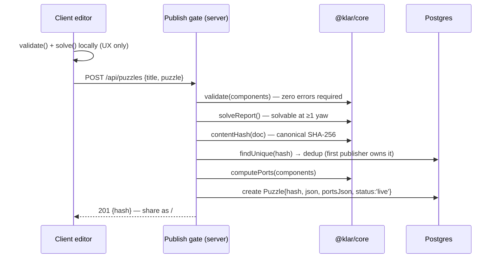

# Klarbase — Engineering Source of Truth

> **Build the illusion. Walk the impossible.**
>
> This is the **single engineering source of truth** for klarbase.dev. It is
> authoritative for the CTO and every developer. The *design* truth lives in
> [`docs/phase0-spec-v4.5.md`](docs/phase0-spec-v4.5.md) (Phase 0 spec, closed);
> this document maps that design onto **what is actually built**, the maths that
> makes it work, the infrastructure that runs it, and the roadmap ahead.
>
> **Last updated:** 2026-08-19 · **Doc owner:** CTO · **Repo:** `TanmoyP/klarbase` (private)

---

## 0. How to use this document

- **Design decisions** (what the game *is*) → belong in the spec (`docs/phase0-spec-v4.5.md`). A change there is a version bump with a stated reason.
- **Engineering reality** (what is *built*, how it scales, what's next) → belongs here.
- **This is a living document.** The last section is a **Session Log**. Every development session appends one entry: what changed, what was learned, what's now unblocked. If you touched architecture, data model, the maths, or infra, update the relevant section *and* add a log entry. A stale source of truth is worse than none.
- **Roadmap sections are deliberately placeholders** for the CEO / CMO / CTO to shape into a committed plan. They capture options and dependencies, not promises.

### Legend

| Marker | Meaning |
|---|---|
| ✅ **Built** | In code, tested or exercised |
| 🟡 **Scaffolded** | Code exists, never run against a live system |
| 🔵 **Designed** | Specified in the spec, not yet coded |
| 🔴 **Proposed** | New this doc, needs CEO/CTO sign-off before build |
| ⚠️ **Gap / risk** | Discrepancy or hazard to resolve |

---

## 1. Product in one screen

Klarbase is a browser game where **Monument Valley's impossible geometry meets LEGO-style building**. Players:

1. **Build** small architectural puzzles by snapping components onto an isometric integer grid.
2. **Break the camera's honesty** — distant walkways line up into *illusion seams* that are traversable only because a fixed orthographic camera collapses their true separation. The avatar walks straight across them.
3. **Publish** puzzles (immutable, content-addressed) and **claim a plot** on a shared lattice, connecting edges to neighbours until the whole city is walkable end to end.

**The one question that governs everything:** *when a player crosses a seam, do they say "bug" or "whoa"?* Nothing else matters if the answer is "bug."

### Design pillars (non-negotiable — the "constitution")

- **Integer grid, 90° yaw only.** No floats anywhere in geometry. This is what keeps illusion detection exact instead of a floating-point tolerance problem.
- **One fixed orthographic camera, true isometric.** Camera on the `(1,1,1)` axis. Yaw quantised to 0/90/180/270. Free-look is a debug tool, never a player feature.
- **Every published puzzle is immutable.** Edits produce new content hashes. This is what makes a persistent world of strangers' content safe.
- **The author owns pigment; the world owns light.** Surface hue is authorship; sky, fog, light, water material, regional hue bias are world-owned. This is the largest lever on world coherence.
- **One source of truth, three call sites.** `@klar/core` is imported by the client editor (pre-commit validation), the client player (traversal), and the server publish gate (validation + solvability). If the server's verdict can differ from the client's, publishing is broken.

### Canonical vocabulary (product-facing)

Naming does semantic work — use these consistently in UI copy, docs, and new code.

| Term | Means | Notes |
|---|---|---|
| **Maquette** | A build unit — the set of components, connections, and avatar spawn/goal state. An architect's scale model of a building, which is exactly what each build is. | Lifecycle is a **status** on the one noun: *draft → published → placed*. "Build a maquette", "walk this maquette". |
| **Plot** | A cell in the world lattice where a published maquette is placed. | Reserved for the world grid. |
| **Seam** | An authored illusion edge (screen-space coincidence made walkable). | Already themed — keep it. |
| Component / piece | Block, Slab, Stairs, Column, Spawn, Goal. | **Literal names, kept as-is** — clarity for builders (risk #2). No cute renames. |
| socket / node / edge / port / lattice | Technical terms in `@klar/core`. | Shared vocabulary with the spec — never renamed in code. |

> ⚠️ **Code vs product term:** the immutable published record is still the `Puzzle` table / `/api/puzzles` in code. Renaming code `Puzzle → Maquette` is a **deferred** task — do it in a dedicated PR *after* the milestone loop is green, so a rename bug can't be confused with untested-wiring bugs. Until then, "Maquette" is the product/UI term; "Puzzle" is the internal name for a *published* maquette.

---

## 2. CodeGraph

### 2.1 Repository structure (post-cleanup, 2026-08-19)

```
klarbase/                        ← git root · GitHub: TanmoyP/klarbase (private)
├── ENGINEERING.md               ← this file — engineering source of truth
├── DEPLOYMENT.md                ← step-by-step Neon + Railway + Cloudflare + DNS runbook
├── CLAUDE.md                    ← Claude Code project instructions (read every session)
├── README.md                    ← quickstart + endpoint map
├── package.json                 ← npm workspaces root (core, server, client)
├── docker-compose.yml           ← local Postgres (+ optional full-stack profile)
├── railway.json                 ← Railway build/deploy config (Dockerfile, healthcheck)
├── .env.example                 ← env contract
├── core/                        @klar/core — THE single source of truth (pure, zero deps)
│   ├── src/
│   │   ├── index.js             barrel export
│   │   ├── components.js        palette, TYPES table, occupancy, walk nodes
│   │   ├── validate.js          validate() — the security boundary
│   │   ├── graph.js             buildGraph() — projection, geometric + illusion edges
│   │   ├── solve.js             BFS solvability (free-turn + per-yaw)
│   │   ├── schema.js            canonical serialization + SHA-256 content hash
│   │   ├── ports.js             edge ports — the plot-to-plot contract
│   │   └── lattice.js           world claim/placement rules
│   └── test/run.mjs             56 assertions — day-one suite (zero deps)
├── server/                      @klar/server — Express 4 + Prisma + better-auth
│   ├── Dockerfile               single-service production image (builds client, serves it)
│   ├── prisma/schema.prisma     User/Session/Account/Verification + Puzzle/Report/Plot
│   └── src/
│       ├── index.js             app wiring; serves client/dist in prod (no CORS)
│       ├── auth.js              better-auth (GitHub + Google), requireAuth middleware
│       ├── db.js                PrismaClient singleton
│       ├── middleware.js        rate limiters (publish/report/world)
│       └── routes/
│           ├── puzzles.js       publish gate, browse, fetch, delete, report
│           └── world.js         claim, place, stream cells, map
├── client/                      @klar/client — Vite + three.js
│   ├── index.html               shell + all CSS
│   ├── vite.config.js           dev proxy /api → :3000
│   └── src/
│       ├── main.js              boot, auth chip, gating, routing, publish/browse flows
│       ├── sandbox.js           the verified Phase 1 game (~1020 lines, imports @klar/core)
│       ├── auth.js              better-auth vanilla client
│       ├── net.js               tiny fetch wrapper
│       └── world/
│           ├── roam.js          free-roam streaming (R=2 Chebyshev window)
│           └── mapview.js       zoomed-out lattice map
├── prototypes/phase1.html       frozen Phase 1 artifact — the regression reference
└── docs/
    ├── phase0-spec-v4.5.md      DESIGN TRUTH (closed) — 16-component vision, water, rotors
    ├── phase3-streaming.md      streaming strategy essay
    ├── game-summary.md          landing copy
    ├── kimi-prompt-pack.md      the prompts that generated the phases
    └── archive/poc/             frozen Kimi POC (phase1 prototype v2–v4, spec history)
```

### 2.2 Module dependency graph

```mermaid
graph TD
  subgraph core["@klar/core — pure, zero deps, isomorphic"]
    components --> graph
    graph --> validate
    graph --> solve
    graph --> ports
    ports --> lattice
    schema
  end

  subgraph client["@klar/client — browser, three.js"]
    sandbox["sandbox.js (editor+player)"]
    roam["world/roam.js"]
    mapview["world/mapview.js"]
    cmain["main.js"]
    cnet["net.js"]
    cauth["auth.js"]
  end

  subgraph server["@klar/server — Express + Prisma"]
    sidx["index.js"]
    spuz["routes/puzzles.js (PUBLISH GATE)"]
    sworld["routes/world.js"]
    sauth["auth.js"]
    sdb["db.js → Postgres"]
  end

  sandbox --> core
  roam --> core
  cmain --> sandbox & roam & mapview & cnet & cauth
  spuz --> core
  sworld --> core
  sidx --> spuz & sworld & sauth
  spuz --> sdb
  sworld --> sdb
  cnet -.HTTP /api.-> sidx

  classDef truth fill:#6fc4b8,stroke:#2a6,color:#111;
  class components,graph,validate,solve,ports,lattice,schema truth;
```

**The load-bearing invariant:** the green core is imported unchanged by both `sandbox.js`/`roam.js` (client) and `routes/puzzles.js`/`routes/world.js` (server). It is **never reimplemented**. This is what guarantees the publish gate and the editor agree.

### 2.3 Critical data flows

**Publish (the security boundary):**



**Free-roam streaming (Phase 3):** avatar crosses a plot boundary → `streamAround(cx,cy)` fetches `GET /api/world/cells?x&y&r=2` → each cell builds a *local* graph via `@klar/core`, offsets node keys into world space, **stitches** matched ports with `port` edges → cells beyond `R+1` are disposed (geometry + materials destroyed). No world-sized graph ever exists. Puzzle docs are content-addressed → cached by hash forever.

---

## 3. The Maths (why the illusion is exact, not fuzzy)

This is the mathematical heart of the game. All of it is integer arithmetic — **no epsilon anywhere**.

### 3.1 Isometric projection

Camera sits on the `(1,1,1)` axis, elevation `atan(1/√2) ≈ 35.264°`. This makes `(1,1,1)` the projection's exact null vector, so a world point collapses to two integers:

```
u = x − z              (horizontal screen axis)
v = h2 − x − z         (vertical screen axis)
```

where **`h2` = height in half-cells** (so slabs get odd values, full blocks even). Two nodes coincide on screen **iff both integers match** — no tolerance.

Under camera yaw θ ∈ {0,1,2,3}, rotate `(x,z)` by `−θ·90°` first (`rot()` in `graph.js`), then apply the same formula. `screenKey(n, yaw)` packs the pair: `(h2 − x' − z')·65536 + (x' − z')`.

### 3.2 The half-cell height table (`components.js`)

| Component | Occupies | Walk node `h2` |
|---|---|---|
| Block | `(x,y,z)` | `2(y+1)` (even) |
| Slab | `(x,y,z)` | `2y+1` (odd) |
| Stairs | `(x,y,z)` | `2(y+1)` — *top is not a walk surface* |
| Column (`v.h`) | `(x,y..y+h−1,z)` | `2(y+h)` |
| Spawn / Goal | `(x,y,z)` | `2(y+1)` |

A walk node exists only if the cell containing the avatar's head — `clearY = ceil(h2/2)` — is empty and inside the plot.

### 3.3 The parity law (why slabs matter)

Since `v = h2 − x − z` and `u = x − z`, we have **`h2 ≡ u + v (mod 2)`**. Therefore:

- **Block nodes always have even `h2`; slab nodes always have odd `h2`.**
- A slab node can **never** coincide on screen with a block node, at any yaw — they live in disjoint parity classes.

Slabs don't "nudge heights into coincidence" (an earlier, algebraically false justification). They **unlock the other half of screen space** — the odd-parity positions blocks can never reach. This is worth nothing unless slabs are reachable, which is why the **half-step** exists: two face-adjacent walk nodes with `|Δh2| = 1` connect freely (only ever block↔slab). The two features stand or fall together.

### 3.4 Illusion edges (opt-in, never automatic)

1. Bucket all walk nodes by `screenKey` for each of the 4 yaws.
2. Any bucket with ≥2 nodes yields **candidate** seams — *unless* the pair is already geometrically adjacent (real adjacency wins).
3. A candidate becomes a **traversable illusion edge only if the author promoted it** into `illusionAllowlist`. Each edge carries a 4-bit yaw mask (`1<<yaw`).

**Why opt-in and not opt-out:** screen-space coincidence is *common*, not rare. A flat 7×7 plaza produces 4 coincidences; a plain 3-step staircase produces 13. Under opt-out, authors would ship a dozen accidental bugs per build. Detection is only ever a candidate list; nothing is walkable until authored. The Penrose condition then falls out for free: a stair run climbing the world diagonal projects onto itself, so a loop that closes in screen space is unbounded in world space. *The camera lies; the geometry is honest.*

### 3.5 Stairs (directed attachment, bidirectional traversal)

A stair at cell `P` facing direction `d` (from `r`) has exactly two sockets on its facing axis:

- **bottom:** node at `P−d`, one level below the stair top.
- **top:** node at `P+d`, level with the stair top.

Nothing attaches to the flanks. Traversal across both edges is bidirectional (you descend by the edge you climb). Flights chain because a stair's bottom socket also accepts a lower stair's top. Canonical orientation: treads ascend toward the facing; `r=0` faces −z (north).

### 3.6 Solvability

BFS over the traversal graph from the single spawn node to any goal node.

- `solve()` — player may turn freely: any edge with a nonzero yaw mask is usable. **This is the publish-gate rule.**
- `solveAtYaw(yaw)` — fixed camera: geometric edges + illusion edges authored for exactly that yaw. Used for diagnostics and future one-yaw challenge modes.

### 3.7 Content hash = identity

`contentHash(doc)` = `SHA-256(stableStringify(canonicalContent(doc)))`, pure JS, identical in browser and Node. Canonical content = **components + illusionAllowlist only** (integers, sorted keys, order-independent). Metadata, palette, timestamps are excluded. Two exports of the same geometry hash identically → free dedup, immutable addressing, and a perfect CDN/cache key. **The hash IS the puzzle's id**, stored outside the document (DB PK, lattice claim).

### 3.8 Ports & lattice (Phase 3)

- **Port:** a boundary walk node projected to `{off, lvl=h2}` on one of 4 edges (n/e/s/w). A promise that the avatar could step flat outward into the neighbour.
- **Compatibility:** *exact equality* of port sets on a shared edge, checked independently on both sides (`portsMatch`). A port the neighbour lacks = walking into nothing; a port you lack = a doorway into a wall. Both broken.
- **Claim rule (`canClaim`):** genesis at `(0,0)`; thereafter a cell must be free and 4-adjacent to an existing plot. No leaps, no enclaves.
- **Placement rule (`canPlace`):** you own the empty plot, and your ports match **every occupied neighbour**. Once placed, **immutable** — there is deliberately no mutation path. This is what stops the world from rotting.
- **Illusion seams never cross plot boundaries** — a seam is plot-local by construction, so unloading a distant cell can never break a neighbour's illusion. This is what makes streaming safe.

---

## 4. Data model & API surface

### 4.1 Postgres schema (Prisma) — ✅ defined, 🟡 never migrated live

| Model | Key | Purpose |
|---|---|---|
| `User` / `Session` / `Account` / `Verification` | — | better-auth managed (GitHub + Google OAuth) |
| `Puzzle` | `hash` (PK) | `title`, `json` (canonical v4 doc), `portsJson`, `status` (pending/live/hidden), `authorId`. Content hash = free dedup + immutable address. |
| `Report` | `cuid` | one per `(puzzleHash, reporterId)`; ≥3 auto-hides |
| `Plot` | `(x,y)` composite PK | `ownerId`, `puzzleHash?` (null = claimed & empty; once set, immutable), `portsJson?` |

### 4.2 API endpoints — 🟡 scaffolded

```
GET    /api/health                        {ok:true}
*      /api/auth/*                         better-auth (OAuth, session)
POST   /api/puzzles                        publish — validate + solve gate (THE boundary)
GET    /api/puzzles?cursor&limit&author=me browse, cursor-paginated
GET    /api/puzzles/:hash                  playable document
DELETE /api/puzzles/:hash                  own only; 409 if placed in world
POST   /api/puzzles/:hash/report           one/user; ≥3 auto-hides
POST   /api/world/claims                   claim free adjacent cell (genesis 0,0)
POST   /api/world/plots/:x/:y/place        place your puzzle; ports must match neighbours
GET    /api/world/cells?x&y&r              stream window for free-roam (r≤4)
GET    /api/world/map                      every claimed cell + author
```

**Rate limits (per user, IP fallback):** publish 20/hr, report 30/hr, world 60/hr. Body cap 512 KB. ⚠️ These counters are **in-memory** — see §7.4 before scaling past one replica.

---

## 5. Current state — the honest ledger

### 5.1 What is real

- ✅ **`@klar/core` is complete and tested** — 56/56 assertions pass on Node 24 (`node core/test/run.mjs`). Covers hashing, canonicalization, validation, geometric + stair + illusion edges, per-yaw solvability, ports, and lattice claim/place rules.
- ✅ **Phase 1 game logic** (the "bug or whoa" question) was answered "whoa" in the frozen POC (`prototypes/phase1.html`, `docs/archive/poc/`). The three teaching presets (First Steps, The Climb, The Seam) validate and solve.
- 🟡 **Server** (Express + Prisma + better-auth) — fully written, syntax-checked in CI, **never run against a live database.**
- 🟡 **Client platform layer** (`main.js`, `roam.js`, `mapview.js`) — written, imports core, **never exercised end to end.**
- ✅ **CI** runs the core suite + `node --check` sanity on every push.

### 5.2 The milestone loop is unproven

**Definition of done for Phase 2 core (from the spec §13):**
> build → publish (server validates + solves) → open the share link in a fresh browser → play to the win — *for a second account*.

This has **never been run against a live DB.** First tasks (from the README):

1. `npm install`, then `prisma migrate dev --name init` (no lockfile/migration committed yet).
2. Verify the `better-auth@^1.1` pin against current docs (mount point, `getSession` shape, client import path — it moves fast).
3. End-to-end smoke of the milestone loop.

### 5.3 ⚠️ Known discrepancies (spec vs. code) — resolve deliberately

| # | Spec (design truth) | Code (implemented) | Disposition |
|---|---|---|---|
| D1 | 16 component types (water, rotors, bridge, arch, parapet, deco, panel…) | **6 types**: block, slab, stairs, column, spawn, goal | Intended Phase 1 subset. The rest are 🔵 designed, not built. Water/rotors are a *parallel client track*. |
| D2 | Lattice cell `24 × 24 × 16` | `PLOT.size = [16, 12, 16]` (`components.js`) | ✅ **RESOLVED 2026-08-19.** Canonical cell locked to **`[16, 12, 16]`**; spec aligned (Revision 4.6) + guard test added (`run.mjs`, 57/57). Enlarging later stays open (pre-launch free; post-launch = migration). A vertical build-height scrubber (+/− / scroll) is an editor-UX backlog item — separate from cell geometry. |
| D3 | Typed edge ports (9 socket types, `flow-in/out`, `stair-top`…) | Ports derived from **boundary walk nodes only** `{off, lvl}` | Simplification: walk-only ports. Sufficient for Phase 3 MVP; the richer socket-typed port model is 🔵 designed. |
| D4 | `plot.ports` promoted/declared in the document | Ports **computed** at publish (`computePorts`) and stored in `portsJson` | Fine — computed is stricter than declared. Note the schema in the spec still shows declared ports. |

### 5.4 Numbers that keep us honest

| Metric | Target / limit | Source |
|---|---|---|
| Core port size | ~400 lines; alarm at 600 | phase2-kickoff |
| Publish-gate latency | < 100 ms for a 100-component puzzle | phase2-kickoff |
| Max components / puzzle | 2000 (`MAX_COMPONENTS`, DoS guard) | `validate.js` |
| Rotor budget (when built) | ≤ 3 (64 states); fallback 2 if editor latency > 100 ms | spec §9.2 |
| Streaming window | Chebyshev R=2 (≤ 25 cells); unload > R+1 | `roam.js` |
| Body cap | 512 KB | `index.js` |
| Nodes per plot | ≲ 100 | phase3-streaming |
| Infra budget | sub-€6/month at MVP scale | founder constraint |

---

## 6. Roadmap — PLACEHOLDER for CEO / CMO / CTO

> These are **options and dependencies**, not commitments. The CEO shapes this into a committed roadmap with the CMO (growth/marketing beats) and CTO (sequencing/risk). Each item lists its dependency and its risk so trade-offs are visible.

### 6.1 Phase ledger

| Phase | Scope | State | Gate to start next |
|---|---|---|---|
| **P1 — Sandbox** | camera, grid, 6 components, illusion seam, avatar, editor doctrine, 3 presets | ✅ done (POC) | "whoa not bug" — answered |
| **P2 — Platform** | repo, auth, publish gate, share links, browse | 🟡 scaffolded | **milestone loop green live** |
| **P2.5 — Maquette drafts & versions** 🔴 | mutable working saves, 5 slots/maquette, upload JSON | 🔴 proposed (§8.1) | P2 loop green |
| **P3 — Shared world** | lattice claim/place, free-roam streaming, map | 🟡 scaffolded | P2 loop green + world design review |
| **P-water** | water/rotors/flow (parallel client track) | 🔵 designed | independent; needs its own build sprint |
| **P4 — Component builder + marketplace** 🔴 | user-authored components, contracts, marketplace | 🔴 proposed (§8.2) | socket model frozen as versioned contract |
| **P5 — Discovery** | spawn-near-activity, featured regions, fast-travel | 🔵 designed | traffic exists (past a few hundred plots) |

### 6.2 Growth/CMO placeholders (to be filled)

- Time-to-first-published-puzzle — the retention metric that matters most (risk #2: editor friction).
- The "screenshot moment" — the Escher waterfall (water crossing a seam feeding its own source). Marketing beat when P-water ships.
- Shareable `/#/p/:hash` links are the viral primitive already in the code.
- Marketplace economics (free vs. paid components, revenue share) — CEO/CMO decision, feeds §8.2.

### 6.3 Open questions for the leadership table

1. **Canonical cell size (D2)** — 16³ or 24×16×24? Blocks any content commitment.
2. ✅ **Resolved** — the build unit is a **Maquette**; draft slots are per-maquette (§8.1). Code term `Puzzle` → `Maquette` rename deferred until after the milestone loop is green.
3. **Marketplace intent** — cosmetic-only components, or mechanics? Mechanics touch the solver and the "constitution" (risk #5). This decides §8.2's boundary.
4. **Moderation posture** at world scale — auto-gate only, or human review queue? Affects P3 go-live.
5. **Anonymous play** — presets only (current) vs. a broader free tier for growth.

---

## 7. Infrastructure & deployment architecture

### 7.1 Chosen topology (opinionated, best-practice)

**Single Railway service (Docker) serving API + built client, Neon Postgres (pooled), Cloudflare in front.**

```mermaid
graph LR
  User -->|klarbase.dev| CF[Cloudflare CDN/WAF]
  CF -->|cache static + immutable docs| RW[Railway service · Express]
  RW -->|serves| Static[client/dist static]
  RW -->|API| Routes[/api/*]
  RW -->|pooled DATABASE_URL| Pool[(Neon pooler / PgBouncer)]
  Pool --> PG[(Neon Postgres · Frankfurt)]
  RW -.migrations: DIRECT_URL.-> PG
  RW --> OAuth[GitHub + Google OAuth]
```

**Why single-service (and not client-on-Vercel) — the reasoning, not the vibe:**

- **Maintainability is won by removing moving parts.** The code is single-origin with zero CORS. Splitting to Vercel now adds cross-origin auth-cookie config, a second deploy pipeline, and split DNS — for a milestone loop that hasn't run live. That's premature.
- **Scalability here is bounded by Postgres + API CPU, never by static serving.** Static is solved by Cloudflare's edge regardless of origin. The API is **stateless** (sessions in Postgres) → scales horizontally via Railway replicas.
- **The upgrade path stays open.** Moving the client to Cloudflare Pages / Vercel on `api.klarbase.dev` later is a config swap (the client already talks to `/api`), not a rewrite. Do it when static traffic or client build complexity justifies it — not before.

### 7.2 Serving 1000+ concurrent users

| Layer | At 1000+ concurrent | Mechanism |
|---|---|---|
| **Static client** | Trivial | Cloudflare caches Vite's content-hashed bundles at the edge; origin barely serves them. |
| **Immutable puzzle docs** | Trivial | `GET /api/puzzles/:hash` and world-cell docs are content-addressed → `Cache-Control: public, max-age=31536000, immutable`. Cloudflare serves repeat reads without touching origin. This offloads the read-heavy world-streaming path almost entirely. |
| **API compute** | Scale out | App is stateless → run **N Railway replicas** behind Railway's load balancer. Health check `/api/health`. |
| **Database connections** | The real bottleneck | Use Neon's **pooled** connection string (`-pooler` host) as `DATABASE_URL` for runtime; **direct** string as `DIRECT_URL` for migrations only (Prisma `directUrl`). PgBouncer transaction pooling lets many replicas share a small connection budget. |
| **Auth session lookups** | Watch | better-auth hits Postgres per authed request. Cloudflare caching immutable GETs keeps most read traffic off the DB; add a short-TTL session cache only if profiling shows it. |
| **Writes (claim/place/publish)** | Low volume, transactional | Already wrapped in Prisma `$transaction` with atomic `updateMany` guards against races. Fine at this scale. |

**Capacity intuition:** this workload is ~90% cacheable reads + light transactional writes + sub-100ms CPU on publish. 1000 concurrent is comfortably one small Railway service + Cloudflare + Neon. Scale replicas on CPU, not on request count.

### 7.3 Do we need cron? **No.**

Unlike a news pipeline, klarbase has **no scheduled ingestion**. Everything — validation, solvability, moderation auto-hide, dedup — is **synchronous on request**. There is no background job the product depends on.

The *only* future candidate is **Phase 3 "world bloom"** (aggregating node-visit/popularity into derived vegetation, keyed by content hash). When that ships it is an **optional Railway service** (a worker or a Railway-native scheduled job on the same repo), **not a GitHub Actions cron** and **not a dependency of the core loop**. Explicitly: prefer Railway service/job deployments over GitHub cron, per the founder's standing preference.

### 7.4 ⚠️ Scaling gotchas to fix *before* they bite

1. **In-memory rate limiter breaks with >1 replica.** `express-rate-limit` keeps counters in process memory; each replica counts independently, so limits multiply by replica count. **Fix before enabling replicas:** move to a shared store (Railway Redis + `rate-limit-redis`) *or* enforce rate limits at Cloudflare's edge. Until fixed, run a **single replica** (still fine for launch traffic).
2. **Prisma + Neon pooler for migrations.** Never run `migrate deploy` through the transaction pooler. Use `DIRECT_URL`. (Configured — see DEPLOYMENT.md.)
3. **`app.set('trust proxy', 1)`** is already set — correct for Railway/Cloudflare edge, required for real client IPs in rate limiting.
4. **Cookie/OAuth config is origin-sensitive.** `BETTER_AUTH_URL`, `CLIENT_ORIGIN`, and OAuth callback URLs must all be the production origin. A mismatch is the #1 first-deploy failure.

### 7.5 Environment contract

| Variable | Where | Purpose |
|---|---|---|
| `DATABASE_URL` | Railway + `.env` | **Pooled** Neon connection (runtime) |
| `DIRECT_URL` | Railway + `.env` | **Direct** Neon connection (migrations only). Locally = same as `DATABASE_URL`. |
| `BETTER_AUTH_SECRET` | Railway | `openssl rand -hex 32` |
| `BETTER_AUTH_URL` | Railway | Production origin, e.g. `https://klarbase.dev` |
| `CLIENT_ORIGIN` | Railway | Same as `BETTER_AUTH_URL` in single-service prod |
| `GITHUB_CLIENT_ID/SECRET` | Railway | GitHub OAuth app |
| `GOOGLE_CLIENT_ID/SECRET` | Railway | Google OAuth app |
| `PORT` | Railway | Defaults 3000 |

Deploy steps: **[`DEPLOYMENT.md`](DEPLOYMENT.md)**.

---

## 8. Proposed subsystems (🔴 need sign-off before build)

### 8.1 Maquettes — draft & version persistence ("5 slots per maquette")

**Requirement (founder):** persist changes users make by uploading JSON; each explicit save is a **timestamped version**; each user gets **max 5 version slots per maquette**.

**Vocabulary (resolved, Open Q #2):** the quota unit is a **Maquette** — a named build a user iterates on (the canonical build-unit noun, see §1). A user has many maquettes; each keeps up to 5 timestamped JSON snapshots. Publishing a maquette produces an immutable, content-hashed **published maquette** (today's `Puzzle` row). Draft and published are two layers of the same noun and must not be conflated:

| | Maquette draft (this proposal) | Published maquette (`Puzzle`, exists) |
|---|---|---|
| Mutability | Mutable working state | Immutable, content-hashed |
| Visibility | Private to the author | Public / in the world |
| Identity | `(userId, maquetteId, versionId)` | `contentHash` |
| Quota | ≤ 5 versions per maquette | unlimited (dedup'd) |
| Purpose | "save my work in progress" | "ship it to the world" |

**Proposed data model:**

```prisma
model Maquette {                    // a user's working build ("maquette")
  id        String   @id @default(cuid())
  ownerId   String
  owner     User     @relation(fields:[ownerId], references:[id], onDelete: Cascade)
  name      String
  createdAt DateTime @default(now())
  updatedAt DateTime @updatedAt
  versions  MaquetteVersion[]
  @@index([ownerId])
}

model MaquetteVersion {             // one timestamped save; ≤5 per maquette
  id         String   @id @default(cuid())
  maquetteId String
  maquette   Maquette @relation(fields:[maquetteId], references:[id], onDelete: Cascade)
  json       String                 // the build document (may be a broken draft — spec §12)
  valid      Boolean                // validate() result at save time (advisory)
  note       String?                // optional author label
  createdAt  DateTime @default(now())
  @@index([maquetteId, createdAt])
}
```

**Proposed API:**

```
POST   /api/maquettes                          create a maquette {name}
GET    /api/maquettes                           list mine (+ latest version meta)
POST   /api/maquettes/:id/versions              save a version {json, note?} → enforces 5-slot quota
GET    /api/maquettes/:id/versions              list versions (newest first)
GET    /api/maquettes/:id/versions/:vid          fetch one version's json
DELETE /api/maquettes/:id/versions/:vid          free a slot
DELETE /api/maquettes/:id                        delete a maquette + all versions
```

**Quota rule (ring buffer, opinionated default):** on the 6th save, evict the **oldest** version in one transaction — *unless* we add explicit slot pinning later. Return the evicted id so the client can surface "replaced your oldest save." Alternative (require the user to free a slot) is more friction; recommend auto-evict with a visible toast.

**Boundaries:** drafts may be broken (editor doctrine §12 allows it); `validate()` runs advisory-only at save. Uploaded JSON is **schema-checked and size-capped** (reuse the 512 KB body limit + `schemaVersion === 4`) but *not* publish-gated — publishing is the separate immutable path. Drafts never enter the world.

**Effort:** 2 models + 1 migration + ~7 endpoints + client "My Maquettes" panel. Small. Sequence *after* the P2 loop is green.

### 8.2 Component builder + marketplace — contract framework

**Founder note (2026-08-19):** *"In future I'd like a component builder and a marketplace. The final code should be integratable with this idea with proper boundaries and definition of component implementation — features, metadata, mandatory or optional configuration, and criteria of component."*

This is the single largest long-term architectural bet, and it collides head-on with **risk #5 (scope creep through the socket model)**. The spec is explicit: *"treat the socket list as the project's constitution. Adding one is a schema major version, a solver update, and an editor redesign."* So the design principle is: **make components a versioned, validated contract — never arbitrary code.**

**Proposed component contract (the boundary that makes a marketplace safe):**

```jsonc
{
  "componentId": "spiral-ramp",        // stable id, namespaced by author for marketplace
  "version": 1,                        // integer; migrations run sequentially
  "schemaVersion": 4,                  // engine schema it targets
  "metadata": {                        // marketplace + editor surface
    "label": "Spiral Ramp",
    "author": "user_4812",
    "tags": ["traversal", "vertical"],
    "license": "…", "price": 0
  },
  "capabilities": {                    // DECLARED, validated — never executable code
    "carriesTraversal": true,          // participates in the graph?
    "carriesFlow": false,              // water?
    "rotatable": true,
    "occludes": false
  },
  "config": {                          // mandatory vs optional, with criteria
    "mandatory": {
      "height": { "type": "int", "min": 1, "max": 4 }
    },
    "optional": {
      "grass": { "type": "bool", "default": true }
    }
  },
  "sockets": [                         // the ONLY way it touches traversal/flow
    { "offset": [0,0,0], "dir": "n", "type": "walk" }
  ],
  "occupancy": [ /* cells, as a function of config — data, not code */ ],
  "criteria": {                        // publish/marketplace acceptance gates
    "maxCells": 12, "mustSupportToGround": true, "sweepMustBeContained": true
  }
}
```

**Non-negotiable boundaries (the constitution, applied to UGC components):**

1. **Components are *data*, not code.** A component is a declarative socket + occupancy + config table. It is never uploaded JavaScript. The solver/validator interpret the declaration; there is no arbitrary execution surface. This is what keeps a stranger's component from breaking the world or the sandbox.
2. **Sockets are the only interface to traversal and flow.** A component earns graph edges *only* through its declared sockets, validated against the existing socket-type table. No new socket *type* without a schema major version (spec §5).
3. **Config has explicit mandatory/optional slots with criteria** (type, range, default). Unknown keys degrade gracefully (spec §1). Missing mandatory keys = validation error.
4. **Every component passes the same acceptance gate as a puzzle:** bounds, non-overlap, support-to-ground, sweep containment, socket legality. Marketplace listing requires passing `criteria`.
5. **Marketplace metadata is provenance, never identity.** Component identity is `(componentId, version)`; pricing/licensing/author live in metadata and never affect validation or hashing.

**Migration path from today:** the current `TYPES` table in `components.js` is *exactly* this contract, hardcoded for 6 types. The refactor is to (a) formalise `TYPES` entries as the contract schema above, (b) load a **curated first-party set** from that schema, then (c) allow user-authored contracts through a validation gate. Steps (a)+(b) are safe to do early and make the socket model self-documenting; step (c) is P4 and needs the socket model frozen as a versioned contract first.

**Do not build P4 until:** the milestone loop is green, the socket model is stable, and the CEO/CMO have decided cosmetic-only vs. mechanic components (Open Q #3). Mechanic components multiply the solver's surface and are a schema-major commitment.

---

## 9. Session Log

> Append one entry per development session. Keep newest first. If you changed architecture, the data model, the maths, or infra, update the relevant section above *and* log it here.

### 2026-08-19 (b) — Cell size locked, vocabulary set
- **Resolved D2:** canonical plot cell = **`[16, 12, 16]`**. Spec amended (Revision 4.6, stated reason); guard test added (`run.mjs`, **57/57**). Enlarging later stays open (post-launch = migration).
- **Naming:** the build unit is a **Maquette** (draft→published→placed as a status on one noun). Pieces stay **literal** (Block/Slab/…); technical terms unchanged. Added a canonical vocabulary table (§1) and rewrote §8.1 (Maquette drafts, 5 slots/maquette). Code `Puzzle → Maquette` rename **deferred** until the milestone loop is green.
- **Backlog:** vertical build-height scrubber (+/− / scroll) — editor UX, separate from cell geometry.
- **Next:** deployment (Neon → Railway → Cloudflare/DNS) + prove the milestone loop live.

### 2026-08-19 (a) — Repo genesis, source of truth, deployment setup
- **Consumed** the full Kimi handoff: spec v4.5, phase2-kickoff, phase3-streaming, and all of `@klar/core` + server + client.
- **Restructured** the folder: flattened the triple-nested `klarbase/klarbase/klarbase/` to a single git root; archived the Kimi POC under `docs/archive/poc/`.
- **Verified** `@klar/core`: **56/56** tests pass on Node 24.
- **Authored** this ENGINEERING.md (CodeGraph, maths, state ledger, roadmap placeholders, infra for 1000+), plus `CLAUDE.md` and `DEPLOYMENT.md`.
- **Decided** deployment topology: single Railway service + Neon (pooled) + Cloudflare; documented the reasoning and the upgrade path.
- **Configured** Prisma `directUrl` (pooled runtime / direct migrations), added `railway.json`.
- **Flagged** ⚠️ D2 (cell size 16³ vs 24×16×24) as the first thing to resolve before any content is published, and the in-memory rate-limiter as a pre-replica fix.
- **Proposed** two subsystems for sign-off: draft/version persistence (§8.1) and the component-contract framework for the future builder + marketplace (§8.2).
- **Open:** milestone loop still unproven against a live DB — the immediate next engineering task.
```
