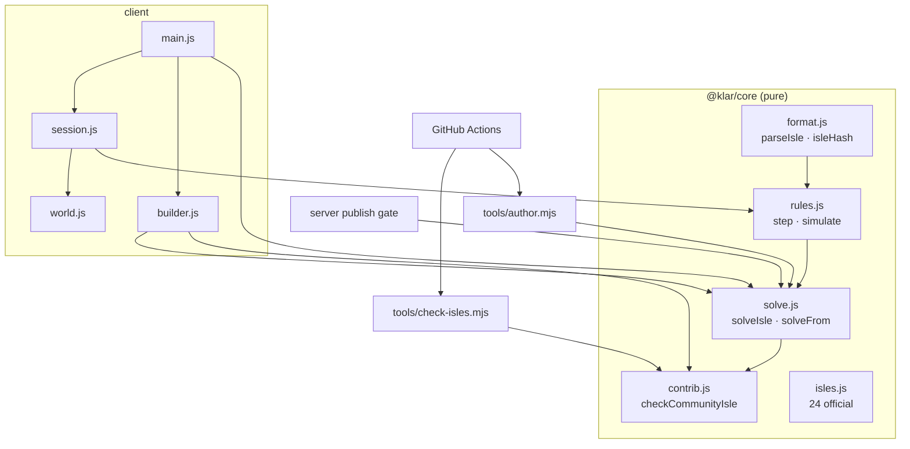

# Klarbase — Engineering Source of Truth (v2: Isles)

> **Tiny floating isles · clever little paths.**
>
> The single engineering source of truth for klarbase.dev — for the CTO, every developer,
> and every AI agent. **v2 (2026-10-18)** replaced the camera-illusion "maquette" game with
> cozy, turn-based **Isles**. The v1 document (voxel engine, illusion maths, the first deploy
> day, sessions a–k) is preserved in [`docs/archive/v1/ENGINEERING-v1.md`](docs/archive/v1/ENGINEERING-v1.md).
>
> **Last updated:** 2026-10-18 · **Owner:** CTO · **Repo:** `TanmoyP/klarbase` (private → going open source)

## 0. How to use this document
- It is **living**. Every session that changes rules, data, infra or the roadmap updates the
  relevant section **and** appends to the Session Log (§13). A stale source of truth is worse than none.
- **Roadmap sections are placeholders** for the CEO / CMO / CTO to turn into commitments.
- The rules of the game are written once in code (`core/src/isle/rules.js`) and once in prose
  (`isles/README.md`). If they ever disagree, the code wins and the prose is a bug.

---

## 1. The game

Klarbase is a cozy puzzle game of **isles**: tiny floating dioramas — terraced cliffs, roots,
waterfalls spilling off the rim, glinting crystals — over a sea of cloud. You guide **Pip**, a
round sprout spirit, one hop per key, to the glowing star. Two loops, one engine:

- **Play** someone else's isle — 24 official isles in five themed chapters, community isles
  merged on GitHub, and isles shared online.
- **Create** your own — paint tiles on a grid, watch the isle grow in 3D, and the solver tells
  you instantly whether it's solvable and its par. Share it online or contribute it by PR.

**Design pillars (non-negotiable):**
1. **Readable.** Discrete, turn-based, one key = one move. ↑ always means "away from you". No
   physics, no timing, no luck — the board tells the whole truth.
2. **Verifiable.** Every isle is checked by a solver: solvable, with an exact par and a
   replayable shortest solution. Nothing unsolvable ships — official, community or online.
3. **Small vocabulary, deep combinations.** ~20 tile types, 7 rules. New mechanics are a schema
   decision, never slipped in (see §11).
4. **Cozy, not punishing.** Undo is free, stars judge your final path, hints are honest
   ("you're stuck — undo"), and the world looks alive even when you're thinking.
5. **Open.** Anyone can build; anyone can contribute by PR; credit is enforced by CI.

**Vocabulary:** *isle* (one puzzle) · *Pip* (the critter) · *par* (shortest solution length) ·
*smart solution* (a shortest key combo, e.g. `RRUULLLUU`) · *chapter* (a theme's set of official
isles) · *official / community / online isle* (where it comes from). Internal code still calls
a stored isle a `Puzzle` (table, `/api/puzzles`) — don't rename in passing.

---

## 2. Architecture (CodeGraph)

```
klarbase/
├── core/                 @klar/core — pure, zero-dep, isomorphic. THE rules.
│   ├── src/isle/         format.js · rules.js · solve.js · contrib.js · isles.js (24 official)
│   ├── src/*.js          legacy voxel engine — kept only for the deferred world API
│   └── test/             isles.mjs (192 assertions) · run.mjs (legacy, 57)
├── client/               @klar/client — Vite + three.js
│   ├── index.html        shell + all CSS (glass UI, responsive)
│   └── src/
│       ├── main.js       screens, routing, catalogue, HUD, solution gating, input
│       ├── builder.js    the isle builder (2D paint + live 3D + live solver + export)
│       └── game/         world.js (scene) · props.js (procedural art) · pip.js (critter)
│                         session.js (play/undo/hint/replay) · audio.js (synth) · themes.js
├── server/               @klar/server — Express + Prisma + better-auth
│   └── src/routes/       puzzles.js (isle publish gate, public play/browse) · world.js (deferred)
├── isles/
│   ├── community/<user>/<id>.json   community isles — bundled into the client with credit
│   ├── README.md         the format + rules for players, contributors and builder bots
│   └── MAINTAINERS       who may edit any community folder
├── content/isles/        generated artifacts for the official isles (deterministic)
├── tools/
│   ├── check-isles.mjs   the PR gate for community isles (zero-dep, data-only)
│   └── author.mjs        verifies official isles, writes content/isles, --seed to DB
└── .github/              ci.yml · CODEOWNERS · PR template · ruleset-main.json
```



**The one architectural rule:** the rules exist only in `@klar/core`. The game, the builder,
the solver, the PR checks, the artifact tool and the server's publish gate all import the same
module — so a player, a reviewer and the server can never disagree about an isle.

**Data flows.**
- *A move:* key → `world.arrowToMove()` (camera-relative) → `step(level, state, move)` →
  `{state, events}` → `world.play()` animates the events in order → HUD updates.
- *A PR isle:* builder **Export for GitHub** (runs `checkCommunityIsle`) → contributor commits
  `isles/community/<me>/<id>.json` → CI `isles` job → required check → merge → next build bundles
  it via `import.meta.glob` → Community tab, credited.
- *An online share:* builder **Share online** (signed in) → `POST /api/puzzles` → server parses +
  solves (budget 200k) → stores canonical isle + par + solution under its content hash → `/#/i/<hash>`.

---

## 3. The isle format

Full spec: [`isles/README.md`](isles/README.md). In short: `rows` of space-separated tokens,
row 0 = north. Token = tile char + optional height digit 0–5.

`. , S G # T ~ * ^ v < > C o D L = _ k K p q -` — ground, flowers, start, goal, rock, tree,
water, ice, four stairs, crate, plate, gate, lever, bridge-up, bridge-down, key, door, arch pair
A, arch pair B, empty sky.

**Limits:** ≤ 14×14, heights 0–5, ≤ 8 crates, exactly one start, ≥ 1 goal, arches in pairs, a
gate needs a plate. **Identity:** `isleHash` = SHA-256 of `{schemaVersion, theme, rows}` with
whitespace normalized — name, author, par, hints never change it. Same isle ⇒ same hash in
browser, Node and DB.

## 4. The rules & engine

The seven rules (also in `rules.js` header and `isles/README.md`):
1. Move one tile N/S/E/W onto floor at the **same height**, **hop down** one level, or **climb
   via stairs** (only along their slope). Never climb a ledge.
2. Walk into a **crate** to push it (same height, or off a one-level ledge). Into **water** it
   sinks and becomes floor.
3. **Ice** slides you (and crates) until something stops you.
4. **Gates** are open while every **plate** is pressed (read at the start of the move).
5. A **lever** (Use / `X`) flips every bridge; a crate on a sinking bridge drops in as a block.
6. **Keys** open **doors** one each; an **arch** sends you to its twin.
7. Reach a **goal**.

**State:** `{p, crates[], filled[], keys, got[], opened[], flip}` — everything that can change.
`step(level, state, move)` is pure and total: it returns `{ok:false}` for a blocked move or
`{ok, state, events, won}` where `events` (`walk/slide/tp/push/cslide/sink/fall/key/door/toggle/gate/win`)
drive animation in order. **Solver:** BFS over `stateKey(state)` from any state (`solveFrom`) —
the first win found is a shortest solution, so `par` is exact. Budgets: 300k states (core
default), 200k (PR checks + server), 150k (in-game hints). **Stars:** ≤ par → 3, ≤ ⌈1.5·par⌉ → 2, else 1.

**Undo** restores the previous state and the move count (stars judge your final path, not
your experiments). **Hints** show the best next move *from where you stand* (`solveFrom`), or
say honestly that this position can no longer reach the goal.

### Solution gating (earned, not handed out)
A solution — and hints beyond the first — unlock for an isle when **any** of:
signed in (contributors sign in with GitHub) · the isle is cleared · real effort on it:
≥ 3:00 of **active** play (only time between moves counts; idle gaps > 20 s are ignored)
**and** ≥ max(30, 3 × par) moves. The builder shows par but hides the route unless signed in;
the server only sends stored solutions to signed-in players. **This is a soft gate by design:**
the engine ships a solver and the repo is open, so a determined player can always extract a
route. The goal is protecting the "aha" for players who try, not secrecy.

---

## 5. Content

**24 official isles, five chapters**, all verified in CI (`core/test/isles.mjs` + `tools/author.mjs`):

| # | Isle | Chapter | Par | Mechanics the solution uses |
|---|---|---|---|---|
| 1 | First Steps | Canopy | 4 | stairs |
| 2 | Ledge Drop | Canopy | 11 | stairs, hop-down |
| 3 | Mossy Crate | Canopy | 9 | push, sink |
| 4 | Root Bridge | Canopy | 12 | stairs, hop-down, push, sink |
| 5 | Fern Gate | Canopy | 15 | push, gate |
| 6 | Mirage | Mirage | 3 | arches |
| 7 | Twin Mirages | Mirage | 7 | arches |
| 8 | Sunken Well | Mirage | 8 | push, sink, arches |
| 9 | Palm Plates | Mirage | 22 | push, gate |
| 10 | Tide Lever | Lagoon | 7 | lever |
| 11 | Low Tide | Lagoon | 14 | lever |
| 12 | Coconut Key | Lagoon | 17 | push, sink, key, door |
| 13 | Lagoon Locks | Lagoon | 16 | key, door (a trap door) |
| 14 | Rooftops | Rooftops | 14 | stairs, push |
| 15 | Canal Lift | Rooftops | 8 | push, lever, crate-drop |
| 16 | Subway | Rooftops | 13 | arches, key, door |
| 17 | Night Market | Rooftops | 17 | push, arches, gate |
| 18 | Crosswalk | Rooftops | 24 | push, gate |
| 19 | First Frost | Summit | 4 | ice |
| 20 | Glacier Stops | Summit | 9 | ice |
| 21 | Snowball | Summit | 11 | push, ice |
| 22 | Glacier Maze | Summit | 13 | ice |
| 23 | Frozen Gate | Summit | 19 | push, ice, crate-slide, gate |
| 24 | The Peak | Summit | 27 | stairs, push, arches, key, door |

**How they were made:** designed in-loop with the solver — a harness flags any isle whose
solution doesn't use its featured mechanic, and the two glacier mazes were found by a
solver-driven search over random rock layouts (kept: longest routes with the most sliding).
Each chapter introduces one idea and ends by combining it with earlier ones.

**Community isles** live in `isles/community/` and reach players on the next build.
**Online isles** live in the database (`Puzzle` rows, `json` = canonical isle + par + solution).
Legacy v4 maquette rows may still exist in prod; the client tells players those links are
from an older version.

## 6. Open-source contribution pipeline

Goal: a stranger's PR is either **rejected automatically** or **safe to merge** — no
hand-checking puzzles.

| Layer | What it enforces |
|---|---|
| `core/src/isle/contrib.js` | the rules: schema & allowed fields, size ≤ 8 KB, plain-text fields with no links, valid grid, solvable within 200k states, `par` exact, `solution` is a shortest winning route, ≥ 6 moves, ≥ 1 real mechanic, unique hash |
| `tools/check-isles.mjs` | the gate: runs the rules on every file, plus **location** (`isles/community/<author>/<id>.json`) and, in PRs, **credit** — the PR author may only add/change/delete files in their own folder (or be in `isles/MAINTAINERS`). Duplicates are blamed on the newcomer. Writes a job summary with each isle's map, par and solution. |
| `.github/workflows/ci.yml` | jobs `engine`, `isles`, `sanity` on every push/PR. `pull_request` event (read-only token, no secrets), no installs, no contributor code executed. |
| Branch ruleset (enable when public) | required checks `engine`/`isles`/`sanity`; Code Owner review for code paths only (`.github/CODEOWNERS`), so isle-only PRs merge on green. Ready to apply: `.github/ruleset-main.json`. |

Verified with 11 simulated stranger-PR scenarios (honest isle ✓; edit/delete someone else's
isle ✗; claimed author ✗; wrong filename ✗; official copy ✗; community copy ✗ blamed on the
copier; malformed JSON ✗; wrong par ✗; non-JSON file ✗; maintainer fix ✓).

---

## 7. Client

- **Look (art direction, inspired by Koldo Huici's floating mini-world):** isometric-ish
  perspective (fov 30, 40° elevation, 28° yaw offset so ↑ ≈ north); terrain columns with
  banded strata on cut faces, hanging root keel, emissive crystals in the rim; waterfalls where
  water meets the edge; low-poly props per theme; grass tufts; gradient sky dome; fog; soft
  PCF shadows; ACES tone mapping. **All procedural — no model or texture files.**
- **Living atmosphere:** clouds drifting *below* the isle, theme particles (fireflies, sand
  motes, petals, lanterns, snow), butterflies or birds, swaying canopies, bobbing keys and
  gems, swirling arches, animated water.
- **Pip:** cream mochi body, bead eyes with glints, blush, leaf sprout that sways, scarf in the
  theme accent; squash & stretch hops, push lean, ice glide, teleport spin, bonk, double-spin
  celebration; blinks; blob shadow.
- **Themes:** jungle (Canopy), oasis (Mirage), tropical (Lagoon), urban (Rooftops), mountain
  (Summit) — palette, light, particles, critters, ambient chord + pentatonic step scale.
- **Audio:** fully synthesized Web Audio; footsteps are scale notes; ambient pad + nature
  layer per theme; starts on first gesture; mute toggle.
- **Controls:** arrows/WASD (camera-relative), Space/Enter/X use, Z undo, R restart, H hint,
  Q/E turn, Esc back; touch d-pad + swipe on coarse pointers.
- **Persistence (per browser, localStorage):** progress (stars, best moves/time), effort for
  solution unlocks, settings (sound, timer), builder draft, GitHub username for exports.
- **Builder:** palette (22 tools), click/drag paint, right-click erase, raise/lower, rotating
  stairs, size 3–14, theme chips, remix any official isle, two-way "Isle code" text, live
  verdict (60k states; Deep check 300k), Test, Share online, Export for GitHub, JSON import/export.
- **Bundle:** ~600 KB / ~166 KB gzip (mostly three.js). Code-splitting the builder is a cheap
  future win.

## 8. Server & API

```
GET    /api/health
*      /api/auth/*                         better-auth (GitHub, Google)
GET    /api/puzzles?cursor&limit[&author=me]   public browse; adds isle/theme/par; author=me needs login
GET    /api/puzzles/:hash                  public play; isle solution only for signed-in players
POST   /api/puzzles   {title, puzzle}      login; isle publish gate: parse → solve (200k) → hash → dedup → store
DELETE /api/puzzles/:hash                  own only
POST   /api/puzzles/:hash/report           login; ≥ 3 reports auto-hide
/api/world/*                               legacy world lattice — deferred, hidden in the UI; isles are refused
```
No schema migration was needed: isles reuse `Puzzle` (`json` holds the canonical isle + `par`
+ `solution`; `portsJson` = `'{}'`). Rate limits unchanged (publish 20/h).

---

## 9. Infrastructure & deployment

Unchanged from v1 — single Railway service (Docker) serving API + built client, Neon Postgres
(pooled runtime / direct migrations), Cloudflare in front, **no cron**. The Dockerfile now also
copies `isles/` so community isles are bundled. Full detail: `docs/archive/v1/ENGINEERING-v1.md` §7
and [`DEPLOYMENT.md`](DEPLOYMENT.md). Scaling gotcha still open: the in-memory rate limiter
must move to a shared store before running more than one replica.

## 10. Current state & numbers

- ✅ Engine: 192 isle assertions + 57 legacy, green. 24 official isles verified; artifacts deterministic.
- ✅ Client: all screens verified in the browser (title, picker with real mini-map thumbnails,
  play, replay, win, lock modal, builder with live verdict, community tab). Phone-width layout done.
- ✅ Contribution pipeline: checker + CI + docs + 11 PR scenarios.
- 🟡 **Not yet deployed.** klarbase.dev still runs v1 until this branch is merged and deployed.
- 🟡 Branch ruleset not applied (repo is private; apply when public).
- 🟡 Official isles not seeded into prod DB (optional — they're bundled anyway).

## 11. Roadmap — placeholders for CEO / CMO / CTO

| Track | Idea | Depends on |
|---|---|---|
| **Builder bot** | "Describe your isle" → LLM writes `rows` → `parseIsle`/`solveIsle`/`checkCommunityIsle` → repair loop → draft in the builder. Never ships unverified output. Claude Haiku for cost. | login, rate limits, cost cap |
| **Isle drafts** | server-side drafts with 5 versioned slots per isle (v1 §8.1 design, renamed) | — |
| **Daily isle** | one community isle featured per day, shared leaderboard by moves/time | traffic |
| **More tiles** | e.g. moving platforms, colour-matched plates/gates, one-way doors. Each one is a schema decision: rules + solver + tests + art + builder tool + docs together | design review |
| **Themes** | snow-night, cherry blossom, deep-sea | art time |
| **World (v1 idea)** | stitch isles into a walkable archipelago | strong demand |
| **Accessibility** | colour-blind-safe arch/plate markers, reduced motion, screen-reader isle summary | — |

**Open questions for the leadership table:**
1. **License** before going public — recommended: MIT for code, CC BY 4.0 for isle content (credit is then a legal requirement, matching the in-game credit).
2. Seed the official isles into prod, or keep them bundled-only?
3. Moderation for online shares: auto-hide at 3 reports today — enough?

## 12. Gotchas (read before deploying or touching auth)

- **better-auth is exact-pinned to `1.4.22`** to match the Prisma schema (1.7 expects `Account.issuer`).
- `railway up --ci` often drops its log stream with a timeout — **not** a failed build; verify via the served bundle hash and `/api/health`.
- Neon `DIRECT_URL` = pooled URL minus `-pooler`. OAuth callbacks must match `BETTER_AUTH_URL` exactly.
- **New rules or tiles:** change `core/src/isle/*`, run `node core/test/isles.mjs` — it re-solves every official isle and reports any par that moved; then `node tools/author.mjs` and commit `content/isles/`.
- **New official isle:** add it to `isles.js`, run the tests — they print the true par and solution to paste in.
- **Browser pane:** this Claude session was started from the byte-mvp folder, so the preview launcher reads `byte-mvp/.claude/launch.json`; start future klarbase sessions from the klarbase folder. Viewport emulation at custom sizes misreports layout — trust the pane's natural size.
- **Secrets:** OAuth secrets and the Neon password were pasted in chat on 2026-08-19 — rotate them.

---

## 13. Session Log

> Newest first. Sessions (a)–(k) of 2026-08-19 are in `docs/archive/v1/ENGINEERING-v1.md`.

### 2026-10-18 (l) — v2: the Isles revamp
- **Founder brief:** replace "maquette" (3–4 letter name → **Isle**); loop = create or play;
  intuitive, buildable by a future builder bot; fix wonkiness; beautiful + cozy character;
  ≥ 20 isles; replayable key-combo solutions; optional timer; themes; open-source contributions
  gated by CI; solutions earned, not free.
- **Decisions:** Isle; cozy turn-based grid puzzles (camera-seam illusion dropped — it was the
  source of "wonky"); world deferred; solutions unlock by sign-in / clear / active effort.
- **Built:** isle engine in `core/src/isle/` (format, rules, BFS solver, contribution rules),
  24 official isles in 5 chapters (solver-verified, featured mechanics load-bearing), new
  client (procedural floating-isle art, Pip, 5 themes, synth audio, HUD, replay, hints,
  builder), server isle publish gate, community pipeline (`isles/`, `tools/check-isles.mjs`,
  CI, CONTRIBUTING, CODEOWNERS, ruleset), deterministic artifacts (`content/isles/`).
- **Removed:** v1 client (`sandbox.js`, `world/roam.js`, `world/mapview.js`), `core/src/curated.js`,
  `content/maquettes/`. Legacy voxel engine kept for the deferred world API.
- **Next:** review PR → merge → deploy → verify klarbase.dev; pick a license; apply the ruleset
  when the repo goes public.
