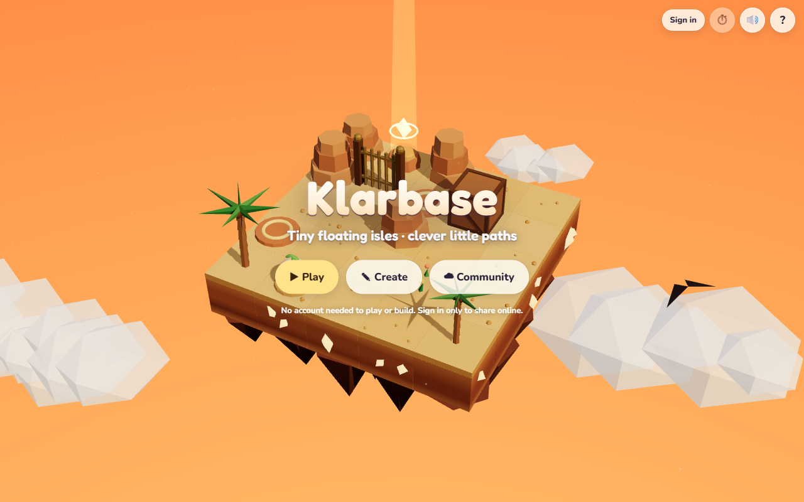
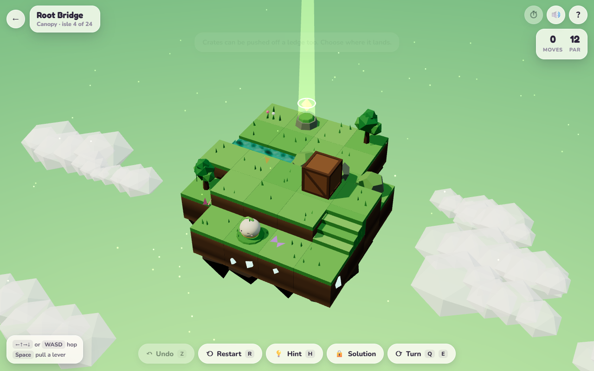
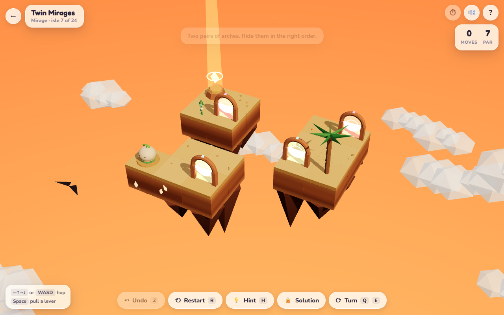
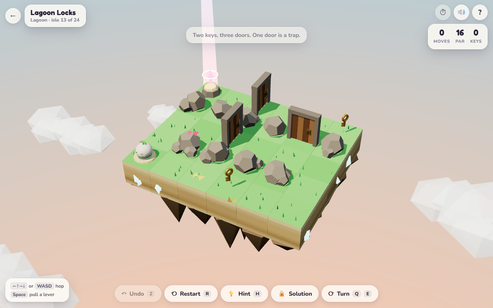
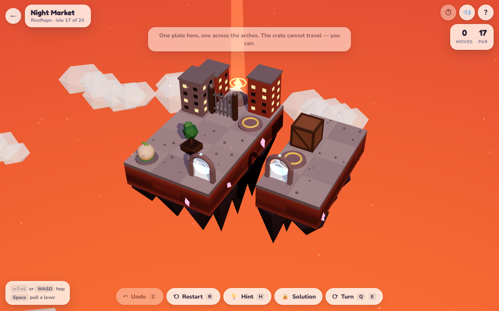
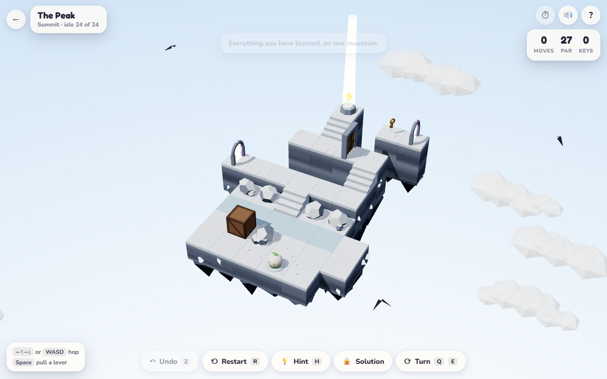
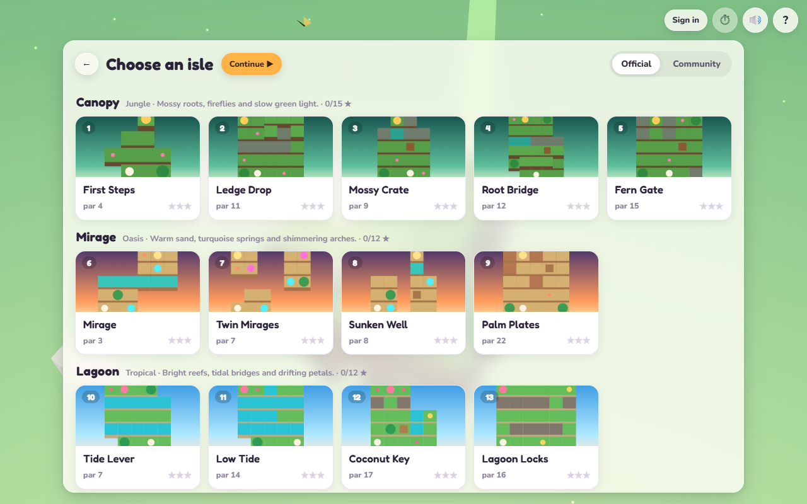
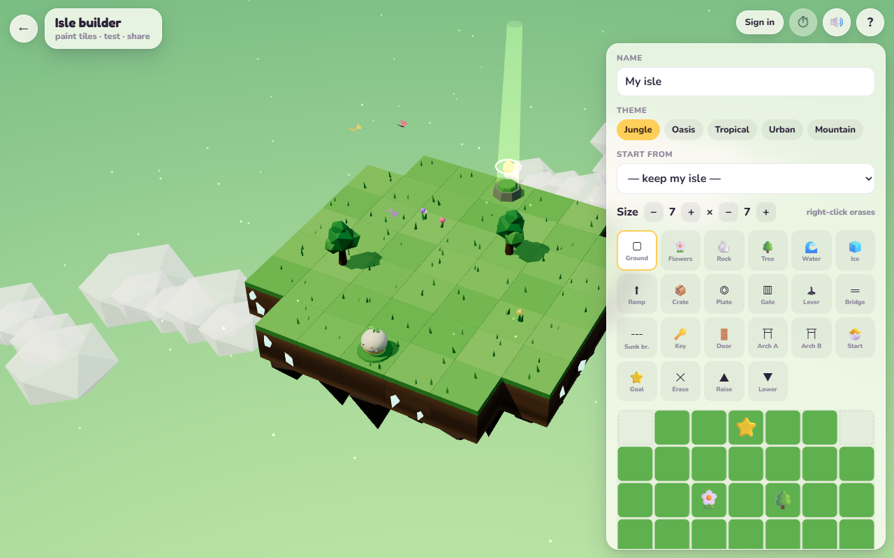

<div align="center">

# Klarbase 🏝️

**Tiny floating isles · clever little paths.**

[**▶ Play at klarbase.dev**](https://klarbase.dev) · [Make an isle](#make-an-isle) · [Contribute](CONTRIBUTING.md) · MIT licensed



</div>

<table>
  <tr>
    <td width="50%"><br><sub><b>Canopy</b> · jungle — push the crate into the spring, climb the stairs</sub></td>
    <td width="50%"><br><sub><b>Mirage</b> · oasis — ride the arches in the right order</sub></td>
  </tr>
  <tr>
    <td width="50%"><br><sub><b>Lagoon</b> · tropical — two keys, three doors, one trap</sub></td>
    <td width="50%"><br><sub><b>Rooftops</b> · urban — plates, gates and a crate that can't travel</sub></td>
  </tr>
  <tr>
    <td width="50%"><br><sub><b>Summit</b> · mountain — everything you've learned, on one peak</sub></td>
    <td width="50%"><br><sub>24 hand-made isles, each with a par and up to three stars</sub></td>
  </tr>
</table>

A cozy browser puzzle game. Guide **Pip**, a round little sprout spirit, across floating
dioramas — push crates into the water to make bridges, slide across ice, pull levers that flip
bridges, step through arches — one hop per key, to the glowing star.

- **24 hand-made isles** in five themed chapters: Canopy (jungle), Mirage (oasis), Lagoon
  (tropical), Rooftops (urban), Summit (mountain) — plus an optional, much harder **Twist** isle
  per chapter, and a **Daily Isle** (`/daily`) with a spoiler-free result to share.
- **Every isle shows its difficulty** (Breeze → Mythic, 0–100): it starts as the maker's gut call
  and settles as people play.
- **Every isle is solver-verified** — solvable, with an exact par and a replayable smart
  solution (earn it by signing in, clearing the isle, or putting in the time).
- **Build your own** in the in-game builder, share it online, or **contribute it here by pull
  request** — automated checks make sure it's solvable and fair, and you're credited by name.

Play at **[klarbase.dev](https://klarbase.dev)**. No account needed to play or build.
Privacy: to rate difficulty the game counts plays, clears, hints, restarts, moves and time per
isle — anonymous totals only; no account, cookie or IP address is stored.

## Make an isle

```text
-  ,1 G1 -  -  -          an isle is just text: one tile per token,
-  .1 ^  -  -  -          row 0 is north, digits are heights
.  .  .  ~  C  .
~  ~  ~  ~  .  .
S  ,  p  -  .  p
```



Build it in the game (**Create**), press **Export for GitHub**, and open a PR that adds
`isles/community/<your-username>/<id>.json`. Full guide: **[CONTRIBUTING.md](CONTRIBUTING.md)** ·
tile reference and rules: **[isles/README.md](isles/README.md)**.

## Run it locally

Needs Node 20+.

```bash
npm install
npm run dev:client          # the game at http://localhost:5173 — play and build, no server needed
npm test                    # engine + all official isles + contribution rules
node tools/check-isles.mjs  # the same check every isle PR runs
```

The online parts (sign-in, sharing) need the server and Postgres — see [DEPLOYMENT.md](DEPLOYMENT.md).

## How it's built

```text
core/     @klar/core — the rules, the solver, the 24 official isles, the contribution rules
client/   Vite + three.js — everything is procedural: no models, no textures, no audio files
server/   Express + Prisma + better-auth — sharing isles online
isles/    community isles, credited to their authors
tools/    check-isles.mjs (the PR gate) · author.mjs (official isle artifacts)
```

The rules live in exactly one place (`core/src/isle/`). The game, the builder, the solver, the
PR checks and the server all use it, so they can never disagree. Engineering notes:
[ENGINEERING.md](ENGINEERING.md).

## License

[MIT](LICENSE) — code and isles alike. Isles you contribute are released under the same
license, and the game always shows who made them. Security reports: [SECURITY.md](SECURITY.md).
